# CoVie — Database Design V1.0

**Phiên bản:** 1.0  
**Ngày:** 08/08/2026  
**Database:** PostgreSQL + PostGIS  
**Mục tiêu:** Thiết kế schema dữ liệu cho CoVie V1 trước bước API Design và Technical Plan.  
**Tài liệu đầu vào:** `CoVie-product-plan-v0.3.md`, `CoVie-user-flow-v1.0.md`, `CoVie-information-architecture-ui-flow-v1.0.md` và các quyết định Database Design đã chốt sau các tài liệu trên.

> **Quy tắc ưu tiên:** các quyết định được chốt trong Database Design này mới hơn và được ưu tiên nếu có mâu thuẫn với tài liệu Product Plan cũ. User Flow V1 vẫn là nguồn chính cho lifecycle nghiệp vụ; Database Design này là nguồn chính cho mô hình lưu trữ dữ liệu.

---

# 1. Mục tiêu thiết kế

Database của CoVie V1 phải đáp ứng các yêu cầu cốt lõi:

1. Một account có thể vừa mua vừa bán.
2. Một user có thể sở hữu/quản lý nhiều `MerchantProfile`.
3. Một `MerchantProfile` có thể có nhiều `MerchantLocation`.
4. Shop và Provider dùng chung `MerchantProfile`.
5. Product và Service dùng chung catalog/variant framework nhưng không trộn chung trong cùng cart/order.
6. Giá và availability thực tế luôn theo từng `MerchantLocation + Variant`.
7. Product có inventory tùy chọn; Service không có inventory.
8. Mọi đơn hàng phải giữ **snapshot bất biến** tại thời điểm checkout.
9. Order lifecycle phải có audit trail append-only.
10. Search, delivery coverage và matching phải hỗ trợ vị trí địa lý hiệu quả.
11. Admin có thể cấu hình rule động mà không deploy lại code.
12. Rating và reputation có aggregate để đọc nhanh nhưng luôn rebuild được từ source of truth.
13. Dữ liệu nghiệp vụ chính dùng soft delete để không phá lịch sử giao dịch.
14. Schema phải đủ mở để CoVie mở rộng khỏi Grand Park mà không redesign cấu trúc lõi.

---

# 2. Nguyên tắc kỹ thuật chung

## 2.1. Primary key

Các entity nghiệp vụ chính dùng **UUIDv7**.

```text
id UUID PRIMARY KEY
```

Lý do:

- khó đoán trên URL/API;
- tốt hơn UUIDv4 về locality của index;
- không phụ thuộc sequence một database;
- thuận tiện khi scale hoặc tách module/service sau này.

Mã hiển thị với user là trường riêng:

```text
orders.id         = UUIDv7
orders.order_code = CV-260808-A82K9
```

`order_code` có unique index nhưng không phải primary key.

## 2.2. Timestamp

Tất cả timestamp nghiệp vụ dùng:

```sql
TIMESTAMPTZ
```

Lưu theo UTC. UI chuyển sang timezone người dùng/location.

Lịch mở cửa dùng `TIME` + timezone của `MerchantLocation`.

## 2.3. Tiền tệ

Không dùng `FLOAT`/`DOUBLE`.

Dùng:

```text
amount BIGINT
currency_code CHAR(3)
```

Với VND:

```text
150000 = 150.000đ
```

Nếu tương lai hỗ trợ currency có minor unit, service layer phải chuẩn hóa theo minor unit của currency.

## 2.4. Trạng thái enum

Ưu tiên `VARCHAR/TEXT + CHECK CONSTRAINT` thay vì PostgreSQL native enum để migration dễ hơn khi lifecycle thay đổi.

Ví dụ:

```sql
status VARCHAR(50) NOT NULL CHECK (status IN (...))
```

## 2.5. Soft delete

Entity nghiệp vụ chính có:

```text
status
deleted_at TIMESTAMPTZ NULL
deleted_by UUID NULL
```

Không hard delete các entity đã từng tham gia giao dịch.

Hard delete chỉ áp dụng cho dữ liệu kỹ thuật/tạm theo retention policy, ví dụ token hết hạn, session cũ, cart item rỗng lâu ngày nếu phù hợp.

## 2.6. Snapshot

Order dùng mô hình **Hybrid Snapshot**:

- cột chuẩn cho dữ liệu cần query/index/report;
- `JSONB` cho dữ liệu đóng băng phục dựng giao dịch.

Snapshot không được thay đổi sau khi order được tạo, trừ metadata kỹ thuật không làm đổi ý nghĩa giao dịch.

## 2.7. Geospatial

Dùng PostGIS:

```sql
GEOGRAPHY(POINT, 4326)
```

với `GIST INDEX` cho:

- Near Me;
- radius search;
- delivery coverage;
- Need Matching;
- distance sorting.

## 2.8. Source of truth và aggregate

Nguyên tắc:

```text
Source tables / append-only events
          ↓
Derived aggregate tables
```

Aggregate dùng để đọc nhanh nhưng phải rebuild được.

---

# 3. Domain boundaries

Database được chia logic theo các domain:

```text
Identity & User
Location
Merchant & Staff
Catalog
Media
Availability & Pricing
Inventory
Delivery & Shipping
Cart
Order & Fulfillment
Need Matching
Review & Reputation
Moderation
Notification
Admin Configuration & Audit
```

Đây là boundary logic; V1 vẫn dùng **một PostgreSQL database** trong kiến trúc Modular Monolith.

---

# 4. ERD tổng thể

```mermaid
erDiagram
    USERS ||--o{ USER_IDENTITIES : has
    USERS ||--o{ USER_ADDRESSES : saves
    USERS ||--o{ MERCHANT_MEMBERSHIPS : joins

    MERCHANT_PROFILES ||--o{ MERCHANT_MEMBERSHIPS : has
    MERCHANT_MEMBERSHIPS ||--o{ MERCHANT_MEMBER_LOCATIONS : scoped_to
    MERCHANT_PROFILES ||--o{ MERCHANT_LOCATIONS : has
    MERCHANT_LOCATIONS ||--o{ MERCHANT_MEMBER_LOCATIONS : assigned

    LOCATION_AREAS ||--o{ LOCATION_AREAS : parent_of
    LOCATION_AREAS ||--o{ USER_ADDRESSES : classifies
    LOCATION_AREAS ||--o{ MERCHANT_LOCATIONS : classifies

    MERCHANT_PROFILES ||--o{ CATALOG_ITEMS : owns
    CATEGORIES ||--o{ CATEGORIES : parent_of
    CATEGORIES ||--o{ CATALOG_ITEMS : primary_category
    CATEGORIES ||--o{ CATEGORY_ATTRIBUTES : defines

    CATALOG_ITEMS ||--o{ CATALOG_ITEM_ATTRIBUTE_VALUES : has
    CATALOG_ITEMS ||--o{ OPTION_GROUPS : has
    OPTION_GROUPS ||--o{ OPTION_VALUES : has
    CATALOG_ITEMS ||--o{ VARIANTS : has
    VARIANTS ||--o{ VARIANT_OPTION_VALUES : composed_of
    OPTION_VALUES ||--o{ VARIANT_OPTION_VALUES : selected

    MERCHANT_LOCATIONS ||--o{ LOCATION_VARIANTS : offers
    VARIANTS ||--o{ LOCATION_VARIANTS : priced_at

    LOCATION_VARIANTS ||--o| INVENTORY_BALANCES : balance
    LOCATION_VARIANTS ||--o{ INVENTORY_RESERVATIONS : reserves
    LOCATION_VARIANTS ||--o{ INVENTORY_MOVEMENTS : ledger

    MERCHANT_LOCATIONS ||--o{ DELIVERY_COVERAGES : has
    DELIVERY_COVERAGES ||--o{ DELIVERY_COVERAGE_AREAS : includes
    LOCATION_AREAS ||--o{ DELIVERY_COVERAGE_AREAS : selected

    MERCHANT_LOCATIONS ||--o{ SHIPPING_POLICIES : has
    SHIPPING_POLICIES ||--o{ SHIPPING_RULES : has

    USERS ||--o{ CARTS : owns
    MERCHANT_LOCATIONS ||--o{ CARTS : scoped_to
    CARTS ||--o{ CART_ITEMS : contains
    VARIANTS ||--o{ CART_ITEMS : references

    USERS ||--o{ ORDERS : buys
    MERCHANT_PROFILES ||--o{ ORDERS : sells
    MERCHANT_LOCATIONS ||--o{ ORDERS : fulfills
    ORDERS ||--o{ ORDER_ITEMS : contains
    ORDERS ||--o{ ORDER_EVENTS : logs
    ORDERS ||--o| PRODUCT_FULFILLMENTS : product_flow
    ORDERS ||--o| SERVICE_FULFILLMENTS : service_flow
    ORDERS ||--o{ ORDER_CANCELLATION_REQUESTS : cancellation
    ORDERS ||--o{ ORDER_ISSUES : issue
    ORDER_ITEMS ||--o| REVIEWS : reviewed

    USERS ||--o{ NEED_REQUESTS : creates
    NEED_REQUESTS ||--o{ NEED_RESPONSES : receives
    MERCHANT_LOCATIONS ||--o{ NEED_RESPONSES : responds
    NEED_RESPONSES ||--o{ NEED_RESPONSE_ITEMS : proposes
    VARIANTS ||--o{ NEED_RESPONSE_ITEMS : references
    NEED_REQUESTS ||--o{ ORDERS : sources

    CATALOG_ITEMS ||--o| CATALOG_ITEM_RATING_STATS : rating_cache
    MERCHANT_PROFILES ||--o| MERCHANT_RATING_STATS : rating_cache
    USERS ||--o| USER_REPUTATION_STATS : reputation_cache
    MERCHANT_PROFILES ||--o| MERCHANT_REPUTATION_STATS : reputation_cache
```



---

# 5. Identity & User

## 5.1. `users`

Tài khoản nghiệp vụ CoVie.

| Column | Type | Null | Ghi chú |
|---|---|---:|---|
| id | UUID | No | UUIDv7 |
| display_name | VARCHAR(120) | No | Tên hiển thị |
| avatar_media_id | UUID | Yes | FK media_assets |
| account_status | VARCHAR(30) | No | ACTIVE/SUSPENDED/BANNED/DELETED |
| created_at | TIMESTAMPTZ | No | |
| updated_at | TIMESTAMPTZ | No | |
| deleted_at | TIMESTAMPTZ | Yes | soft delete |
| version | BIGINT | No | optimistic locking nếu cần |

Không nhét email/phone/password trực tiếp vào `users`.

## 5.2. `user_identities`

Một user có nhiều phương thức đăng nhập.

| Column | Type | Null | Ghi chú |
|---|---|---:|---|
| id | UUID | No | |
| user_id | UUID | No | FK users |
| provider | VARCHAR(30) | No | EMAIL/PHONE/GOOGLE/FACEBOOK/... |
| provider_subject | VARCHAR(255) | Yes | ID từ OAuth provider |
| email_normalized | VARCHAR(320) | Yes | |
| phone_normalized | VARCHAR(30) | Yes | E.164 khi có thể |
| password_hash | VARCHAR(255) | Yes | chỉ local credential |
| verified_at | TIMESTAMPTZ | Yes | |
| created_at | TIMESTAMPTZ | No | |
| last_used_at | TIMESTAMPTZ | Yes | |

Ràng buộc unique theo identity thực tế, ví dụ email normalized hoặc `(provider, provider_subject)`.

## 5.3. `user_contact_methods`

Thông tin liên hệ nghiệp vụ, tách khỏi auth identity.

| Column | Type | Null | Ghi chú |
|---|---|---:|---|
| id | UUID | No | |
| user_id | UUID | No | |
| contact_type | VARCHAR(30) | No | PHONE/ZALO/MESSENGER/OTHER |
| value | TEXT | No | link/số liên hệ |
| is_primary | BOOLEAN | No | default false |
| is_verified | BOOLEAN | No | default false |
| status | VARCHAR(20) | No | ACTIVE/INACTIVE |
| created_at | TIMESTAMPTZ | No | |

Dùng để provider có thể liên hệ buyer sau khi xác nhận service order.

## 5.4. `user_addresses`

Buyer được lưu nhiều địa chỉ.

| Column | Type | Null | Ghi chú |
|---|---|---:|---|
| id | UUID | No | |
| user_id | UUID | No | |
| label | VARCHAR(80) | No | Nhà/Công ty/Sảnh S5.03... |
| recipient_name | VARCHAR(120) | Yes | |
| phone | VARCHAR(30) | Yes | |
| address_text | TEXT | No | |
| location_area_id | UUID | Yes | node chi tiết nhất biết được |
| geo_point | GEOGRAPHY(Point,4326) | No | pin thực tế |
| pin_source | VARCHAR(30) | No | GPS/GEOCODED/USER_ADJUSTED |
| note | TEXT | Yes | |
| is_default | BOOLEAN | No | |
| status | VARCHAR(20) | No | ACTIVE/DELETED |
| created_at | TIMESTAMPTZ | No | |
| updated_at | TIMESTAMPTZ | No | |
| deleted_at | TIMESTAMPTZ | Yes | |

Index:

- `(user_id, status)`
- `GIST(geo_point)`
- partial unique cho một default address/user nếu implementation chọn enforce DB.

---

# 6. Location hierarchy

## 6.1. `location_areas`

Cây địa lý linh hoạt thay vì hard-code Community → Zone → Building.

| Column | Type | Null | Ghi chú |
|---|---|---:|---|
| id | UUID | No | |
| parent_id | UUID | Yes | self FK |
| area_type | VARCHAR(40) | No | COMMUNITY/ZONE/CLUSTER/BUILDING/WARD/... |
| name | VARCHAR(180) | No | |
| slug | VARCHAR(200) | No | |
| path_cache | TEXT | Yes | cache materialized path/ltree nếu dùng |
| geo_boundary | GEOGRAPHY(MultiPolygon,4326) | Yes | optional/future |
| status | VARCHAR(20) | No | ACTIVE/INACTIVE/DELETED |
| sort_order | INT | No | |
| created_at | TIMESTAMPTZ | No | |
| updated_at | TIMESTAMPTZ | No | |

Ví dụ:

```text
Vinhomes Grand Park [COMMUNITY]
└── The Origami [ZONE]
    └── S10.03 [BUILDING]
```

`parent_id` là nguồn quan hệ chính. `path_cache` chỉ là dữ liệu tối ưu truy vấn và có thể rebuild.

---

# 7. Merchant & Staff

## 7.1. `merchant_profiles`

Shop và Provider dùng chung entity.

| Column | Type | Null | Ghi chú |
|---|---|---:|---|
| id | UUID | No | |
| name | VARCHAR(180) | No | |
| slug | VARCHAR(200) | No | public URL |
| description | TEXT | Yes | |
| logo_media_id | UUID | Yes | |
| cover_media_id | UUID | Yes | |
| merchant_status | VARCHAR(30) | No | ACTIVE/PAUSED/SUSPENDED/DELETED |
| moderation_status | VARCHAR(30) | No | nếu cần ở profile level |
| created_at | TIMESTAMPTZ | No | |
| updated_at | TIMESTAMPTZ | No | |
| deleted_at | TIMESTAMPTZ | Yes | |

Không có `owner_user_id` trực tiếp. Ownership đi qua membership.

## 7.2. `merchant_memberships`

| Column | Type | Null | Ghi chú |
|---|---|---:|---|
| id | UUID | No | |
| merchant_profile_id | UUID | No | |
| user_id | UUID | No | |
| role | VARCHAR(20) | No | OWNER/MANAGER/STAFF |
| membership_status | VARCHAR(20) | No | ACTIVE/INVITED/REVOKED |
| joined_at | TIMESTAMPTZ | Yes | |
| created_at | TIMESTAMPTZ | No | |

Unique `(merchant_profile_id, user_id)` cho membership active theo rule implementation.

## 7.3. `merchant_member_locations`

Giới hạn quyền nhân viên theo location.

| Column | Type | Null |
|---|---|---:|
| id | UUID | No |
| membership_id | UUID | No |
| merchant_location_id | UUID | No |
| created_at | TIMESTAMPTZ | No |

Unique `(membership_id, merchant_location_id)`.

`OWNER` mặc định được quyền toàn bộ MerchantProfile; mapping location chủ yếu cho MANAGER/STAFF.

## 7.4. `merchant_locations`

| Column | Type | Null | Ghi chú |
|---|---|---:|---|
| id | UUID | No | |
| merchant_profile_id | UUID | No | |
| name | VARCHAR(150) | No | Tên điểm bán/phục vụ |
| address_text | TEXT | No | |
| location_area_id | UUID | Yes | |
| geo_point | GEOGRAPHY(Point,4326) | No | pin seller chỉnh được |
| pin_source | VARCHAR(30) | No | GPS/GEOCODED/USER_ADJUSTED |
| timezone | VARCHAR(60) | No | default Asia/Ho_Chi_Minh |
| location_status | VARCHAR(30) | No | ACTIVE/PAUSED/DELETED |
| pickup_enabled | BOOLEAN | No | product pickup |
| seller_delivery_enabled | BOOLEAN | No | product delivery |
| service_enabled | BOOLEAN | No | location cung cấp service |
| minimum_delivery_order | BIGINT | Yes | null = không yêu cầu |
| currency_code | CHAR(3) | No | VND V1 |
| created_at | TIMESTAMPTZ | No | |
| updated_at | TIMESTAMPTZ | No | |
| deleted_at | TIMESTAMPTZ | Yes | |

Index:

- `(merchant_profile_id, location_status)`
- `GIST(geo_point)`
- `(location_area_id)`

## 7.5. `merchant_contact_methods`

Contact chung hoặc riêng từng location.

| Column | Type | Null | Ghi chú |
|---|---|---:|---|
| id | UUID | No | |
| merchant_profile_id | UUID | No | |
| merchant_location_id | UUID | Yes | null = profile-level |
| contact_type | VARCHAR(30) | No | ZALO_LINK/ZALO_QR/MESSENGER_LINK/PHONE/OTHER |
| value | TEXT | Yes | |
| qr_media_id | UUID | Yes | QR Zalo; **không dùng cho QR ngân hàng V1** |
| is_primary | BOOLEAN | No | |
| is_public | BOOLEAN | No | |
| status | VARCHAR(20) | No | ACTIVE/INACTIVE |
| created_at | TIMESTAMPTZ | No | |

Resolver ưu tiên contact location trước, fallback contact profile.

## 7.6. `merchant_location_hours`

Lịch tuần.

| Column | Type |
|---|---|
| id | UUID |
| merchant_location_id | UUID |
| day_of_week | SMALLINT |
| operation_type | VARCHAR(20) |
| open_time | TIME |
| close_time | TIME |
| is_closed | BOOLEAN |

`operation_type`:

- SHOP
- DELIVERY
- PICKUP

Có thể có nhiều interval cùng ngày nếu sau này cần nghỉ giữa ca; V1 nên cho phép nhiều row/day/type thay vì unique một row cứng.

## 7.7. `merchant_location_hour_exceptions`

Ngoại lệ theo ngày.

| Column | Type |
|---|---|
| id | UUID |
| merchant_location_id | UUID |
| local_date | DATE |
| operation_type | VARCHAR(20) |
| open_time | TIME NULL |
| close_time | TIME NULL |
| is_closed | BOOLEAN |
| note | TEXT NULL |

Exception ưu tiên hơn weekly schedule.

---

# 8. Media

## 8.1. `media_assets`

Quản lý metadata file tập trung; binary lưu ở object storage.

| Column | Type |
|---|---|
| id | UUID |
| owner_user_id | UUID NULL |
| storage_provider | VARCHAR(30) |
| storage_key | TEXT |
| mime_type | VARCHAR(120) |
| size_bytes | BIGINT |
| width | INT NULL |
| height | INT NULL |
| checksum | VARCHAR(128) NULL |
| media_status | VARCHAR(20) |
| created_at | TIMESTAMPTZ |
| deleted_at | TIMESTAMPTZ NULL |

Không lưu raw image bytes trong PostgreSQL.

## 8.2. `catalog_item_media`

| Column | Type |
|---|---|
| catalog_item_id | UUID |
| media_asset_id | UUID |
| media_type | VARCHAR(20) |
| sort_order | INT |
| is_primary | BOOLEAN |

## 8.3. `merchant_media`

Có thể dùng ngoài logo/cover nếu sau này shop gallery.

---

# 9. Category, tags & structured attributes

## 9.1. `categories`

Category dạng cây.

| Column | Type |
|---|---|
| id | UUID |
| parent_id | UUID NULL |
| name | VARCHAR(160) |
| slug | VARCHAR(180) |
| catalog_type | VARCHAR(20) |
| status | VARCHAR(20) |
| sort_order | INT |
| deleted_at | TIMESTAMPTZ NULL |

`catalog_type = PRODUCT | SERVICE | BOTH` để UI có thể lọc category phù hợp.

## 9.2. `category_attributes`

Định nghĩa filter có cấu trúc.

| Column | Type |
|---|---|
| id | UUID |
| category_id | UUID |
| name | VARCHAR(120) |
| attribute_key | VARCHAR(100) |
| data_type | VARCHAR(30) |
| is_required | BOOLEAN |
| is_filterable | BOOLEAN |
| sort_order | INT |

`data_type` có thể gồm:

- TEXT
- NUMBER
- BOOLEAN
- SINGLE_SELECT
- MULTI_SELECT

## 9.3. `category_attribute_options`

Option cho SINGLE/MULTI_SELECT.

## 9.4. `catalog_item_attribute_values`

Giá trị item theo attribute.

Có thể dùng các cột nullable:

```text
value_text
value_number
value_boolean
attribute_option_id
```

Với multi-select: nhiều row cho cùng `(catalog_item_id, category_attribute_id)` nhưng khác option.

## 9.5. Tags

`tags` + `catalog_item_tags` dùng cho keyword linh hoạt, không thay thế structured attributes.

---

# 10. Catalog & Variant

## 10.1. `catalog_items`

Product và Service dùng chung entity.

| Column | Type | Null | Ghi chú |
|---|---|---:|---|
| id | UUID | No | |
| merchant_profile_id | UUID | No | owner |
| item_type | VARCHAR(20) | No | PRODUCT/SERVICE |
| listing_kind | VARCHAR(20) | No | STANDARD/RESALE |
| primary_category_id | UUID | No | |
| name | VARCHAR(220) | No | |
| slug | VARCHAR(240) | No | |
| description | TEXT | Yes | |
| listing_status | VARCHAR(30) | No | DRAFT/ACTIVE/PAUSED/DELETED |
| moderation_status | VARCHAR(30) | No | NOT_REQUIRED/PENDING/APPROVED/REJECTED/HIDDEN |
| search_vector | TSVECTOR | Yes | derived/indexed |
| created_at | TIMESTAMPTZ | No | |
| updated_at | TIMESTAMPTZ | No | |
| deleted_at | TIMESTAMPTZ | Yes | |

Rules:

- `RESALE` chỉ hợp lệ với `PRODUCT`.
- Service không dùng “giá từ” hay “liên hệ báo giá” làm giá của catalog item.
- Giá không nằm ở `catalog_items`.
- Listing visible khi seller state + moderation state đều cho phép.

Gợi ý visibility:

```text
listing_status = ACTIVE
AND moderation_status IN (NOT_REQUIRED, APPROVED)
AND deleted_at IS NULL
```

## 10.2. `option_groups`

Nhóm phân loại buyer phải chọn khi mua.

Ví dụ:

```text
Áo thun
├── Màu
└── Size
```

hoặc:

```text
Vệ sinh máy lạnh
├── Loại máy
└── Số lượng máy
```

Columns chính:

```text
id
catalog_item_id
name
sort_order
```

## 10.3. `option_values`

```text
id
option_group_id
value
sort_order
```

## 10.4. `variants`

**Mọi CatalogItem luôn có ít nhất một Variant.**

Nếu item không có phân loại UI, hệ thống tạo `DEFAULT_VARIANT` ẩn.

| Column | Type | Null |
|---|---|---:|
| id | UUID | No |
| catalog_item_id | UUID | No |
| sku | VARCHAR(120) | Yes |
| variant_name | VARCHAR(240) | No |
| is_default | BOOLEAN | No |
| variant_status | VARCHAR(20) | No |
| sort_order | INT | No |
| created_at | TIMESTAMPTZ | No |
| updated_at | TIMESTAMPTZ | No |
| deleted_at | TIMESTAMPTZ | Yes |

Không lưu giá trên Variant.

## 10.5. `variant_option_values`

Join variant ↔ option value.

```text
variant_id
option_value_id
```

Unique `(variant_id, option_value_id)`.

Application phải đảm bảo một variant không chọn hai value thuộc cùng một OptionGroup.

## 10.6. `location_variants`

Đây là **nguồn giá và availability thực tế**.

| Column | Type | Null | Ghi chú |
|---|---|---:|---|
| id | UUID | No | |
| merchant_location_id | UUID | No | |
| variant_id | UUID | No | |
| price | BIGINT | No | minor unit |
| currency_code | CHAR(3) | No | |
| is_available | BOOLEAN | No | |
| inventory_mode | VARCHAR(20) | Yes | TRACKED/UNTRACKED; NULL cho SERVICE |
| preparation_time_minutes | INT | Yes | PRODUCT optional |
| created_at | TIMESTAMPTZ | No | |
| updated_at | TIMESTAMPTZ | No | |
| deleted_at | TIMESTAMPTZ | Yes | |
| version | BIGINT | No | optimistic locking |

Unique active `(merchant_location_id, variant_id)`.

Rules:

```text
PRODUCT → inventory_mode = TRACKED | UNTRACKED
SERVICE → inventory_mode = NULL
```

SERVICE `CartItem/OrderItem.quantity` luôn bằng `1`; quy mô dịch vụ thể hiện bằng Variant.

---

# 11. Inventory

Inventory chỉ áp dụng cho `PRODUCT + TRACKED`.

## 11.1. `inventory_balances`

Trạng thái hiện tại để checkout nhanh.

| Column | Type |
|---|---|
| location_variant_id | UUID PK/FK |
| stock_on_hand | BIGINT |
| reserved_quantity | BIGINT |
| updated_at | TIMESTAMPTZ |
| version | BIGINT |

Derived:

```text
available_quantity = stock_on_hand - reserved_quantity
```

Constraint:

```text
stock_on_hand >= 0
reserved_quantity >= 0
reserved_quantity <= stock_on_hand
```

Không nhất thiết lưu `available_quantity` vật lý; có thể tính từ hai cột.

## 11.2. `inventory_reservations`

Cho biết hàng đang giữ cho order nào.

| Column | Type | Null |
|---|---|---:|
| id | UUID | No |
| location_variant_id | UUID | No |
| order_id | UUID | No |
| order_item_id | UUID | No |
| quantity | BIGINT | No |
| reservation_status | VARCHAR(20) | No |
| expires_at | TIMESTAMPTZ | Yes |
| created_at | TIMESTAMPTZ | No |
| committed_at | TIMESTAMPTZ | Yes |
| released_at | TIMESTAMPTZ | Yes |

Status:

- ACTIVE
- COMMITTED
- RELEASED

## 11.3. `inventory_movements`

Append-only ledger.

| Column | Type | Null |
|---|---|---:|
| id | UUID | No |
| location_variant_id | UUID | No |
| movement_type | VARCHAR(40) | No |
| quantity | BIGINT | No |
| order_id | UUID | Yes |
| order_item_id | UUID | Yes |
| reservation_id | UUID | Yes |
| actor_user_id | UUID | Yes |
| reason_code | VARCHAR(60) | Yes |
| metadata | JSONB | Yes |
| created_at | TIMESTAMPTZ | No |

Movement types:

- STOCK_IN
- STOCK_OUT
- RESERVE
- RELEASE_RESERVATION
- SALE
- ADJUSTMENT_IN
- ADJUSTMENT_OUT

Không update/delete movement cũ trong vận hành bình thường.

## 11.4. Reservation lifecycle

```text
Order created
→ ACTIVE reservation

Order rejected / expired / cancelled before fulfillment
→ RELEASED

Seller cancellation after confirmation
→ RELEASED

Buyer cancellation after confirmation được seller chấp nhận
→ RELEASED

BUYER_NO_SHOW
→ RELEASED

COMPLETED
→ COMMITTED + SALE movement
```

Với các terminal state không xác định rõ việc hàng còn ở seller hay đã rời seller, ví dụ `CLOSED_WITH_ISSUE` sau khi seller tuyên bố đã giao, **không tự động restock**. Ưu tiên tránh tăng tồn kho giả; seller có thể dùng inventory adjustment nếu hàng thực tế quay về kho.

## 11.5. Transaction rule khi checkout

Với tracked inventory:

1. Lock `inventory_balances` của các location variant cần mua theo thứ tự ổn định để giảm deadlock.
2. Revalidate `available_quantity`.
3. Tạo `orders` + `order_items`.
4. Tạo reservation.
5. Tăng `reserved_quantity`.
6. Ghi `RESERVE` movement.
7. Commit transaction.

Không cho hai buyer cùng reserve món cuối cùng.

---

# 12. Delivery coverage

Product delivery và Service area **tách riêng**.

## 12.1. `delivery_coverages`

| Column | Type | Null |
|---|---|---:|
| id | UUID | No |
| merchant_location_id | UUID | No |
| coverage_type | VARCHAR(30) | No |
| radius_enabled | BOOLEAN | No |
| radius_meters | INT | Yes |
| area_enabled | BOOLEAN | No |
| coverage_status | VARCHAR(20) | No |
| created_at | TIMESTAMPTZ | No |
| updated_at | TIMESTAMPTZ | No |

`coverage_type`:

- PRODUCT_DELIVERY
- SERVICE_AREA

Một location có thể bật Radius, Zone hoặc cả hai.

## 12.2. `delivery_coverage_areas`

```text
id
delivery_coverage_id
location_area_id
```

Unique `(delivery_coverage_id, location_area_id)`.

## 12.3. Delivery eligibility

```text
within_radius = distance(location.geo_point, buyer.geo_point) <= radius_meters
inside_area   = buyer location area nằm trong một selected area hoặc descendant của selected area

can_deliver = within_radius OR inside_area
```

Nếu chỉ bật một mode thì mode còn lại được bỏ qua.

V1 không đặt giới hạn cứng radius ở business rule; UI/admin có thể áp giới hạn nếu cần sau này.

---

# 13. Shipping policy

Chỉ áp dụng cho `PRODUCT` seller delivery.

## 13.1. `shipping_policies`

| Column | Type | Null |
|---|---|---:|
| id | UUID | No |
| merchant_location_id | UUID | No |
| mode | VARCHAR(30) | No |
| base_fee | BIGINT | Yes |
| currency_code | CHAR(3) | No |
| rule_match_mode | VARCHAR(10) | Yes |
| policy_status | VARCHAR(20) | No |
| created_at | TIMESTAMPTZ | No |
| updated_at | TIMESTAMPTZ | No |

Mode:

- FREE
- FIXED
- NEGOTIATED
- CONDITIONAL

`rule_match_mode`:

- ANY
- ALL

Rules:

- FREE → effective fee = 0
- FIXED → `base_fee` required
- NEGOTIATED → shipping fee **unknown/null**, không phải 0
- CONDITIONAL → `base_fee` + shipping rules

## 13.2. `shipping_rules`

| Column | Type | Null |
|---|---|---:|
| id | UUID | No |
| shipping_policy_id | UUID | No |
| condition_type | VARCHAR(30) | No |
| operator | VARCHAR(10) | No |
| threshold_value | BIGINT | No |
| action_type | VARCHAR(30) | No |
| priority | INT | No |
| enabled | BOOLEAN | No |

V1 condition:

- ORDER_AMOUNT_MIN
- DISTANCE_MAX

V1 action:

- FREE_SHIPPING

Ví dụ:

```text
base_fee = 10000
rule_match_mode = ANY

Rule 1: ORDER_AMOUNT_MIN >= 150000 → FREE_SHIPPING
Rule 2: DISTANCE_MAX <= 500m       → FREE_SHIPPING
```

## 13.3. Snapshot

Order phải lưu `shipping_policy_snapshot JSONB` chứa:

- mode;
- base fee;
- rules;
- distance đã dùng;
- subtotal đã dùng;
- effective result;
- currency.

Seller sửa shipping policy sau này không làm đổi đơn cũ.

---

# 14. Cart

## 14.1. `carts`

Một user chỉ có **một active cart** cho mỗi:

```text
User + MerchantLocation + CartType
```

| Column | Type |
|---|---|
| id | UUID |
| user_id | UUID |
| merchant_location_id | UUID |
| cart_type | VARCHAR(20) |
| cart_status | VARCHAR(20) |
| created_at | TIMESTAMPTZ |
| updated_at | TIMESTAMPTZ |
| version | BIGINT |

`cart_type = PRODUCT | SERVICE`.

Partial unique index gợi ý:

```sql
UNIQUE (user_id, merchant_location_id, cart_type)
WHERE cart_status = 'ACTIVE';
```

## 14.2. `cart_items`

| Column | Type | Null |
|---|---|---:|
| id | UUID | No |
| cart_id | UUID | No |
| variant_id | UUID | No |
| quantity | BIGINT | No |
| price_snapshot | BIGINT | No |
| item_name_snapshot | VARCHAR(220) | No |
| variant_snapshot | JSONB | Yes |
| added_at | TIMESTAMPTZ | No |
| updated_at | TIMESTAMPTZ | No |

Rules:

- PRODUCT → quantity >= 1
- SERVICE → quantity = 1
- Cart snapshot **không khóa giá**.

## 14.3. Checkout revalidation

Trước khi tạo Order phải kiểm tra lại:

1. Catalog item chưa bị xóa.
2. `listing_status = ACTIVE`.
3. Moderation cho phép hiển thị/bán.
4. Variant còn active.
5. LocationVariant còn available.
6. Giá hiện tại.
7. Inventory hiện tại nếu tracked.
8. MerchantLocation đang hoạt động/phù hợp.
9. Minimum delivery order.
10. Coverage.
11. Shipping policy.

Nếu giá thay đổi:

```text
Cart snapshot 45k
Current 50k
→ buyer phải thấy thay đổi và xác nhận lại
```

Order chỉ snapshot giá **sau revalidation**.

---

# 15. Orders

## 15.1. `orders`

Một bảng chung cho Product và Service.

| Column | Type | Null | Ghi chú |
|---|---|---:|---|
| id | UUID | No | UUIDv7 |
| order_code | VARCHAR(32) | No | public unique code |
| order_type | VARCHAR(20) | No | PRODUCT/SERVICE |
| buyer_user_id | UUID | No | |
| merchant_profile_id | UUID | No | |
| merchant_location_id | UUID | No | |
| status | VARCHAR(60) | No | current state |
| source_type | VARCHAR(20) | No | MARKETPLACE/NEED_REQUEST |
| source_need_request_id | UUID | Yes | |
| source_need_response_item_id | UUID | Yes | |
| payment_method | VARCHAR(40) | No | COD/BANK_TRANSFER_NEGOTIATED |
| subtotal | BIGINT | No | item total |
| shipping_fee_type | VARCHAR(30) | Yes | FREE/FIXED/CONDITIONAL/NEGOTIATED/NOT_APPLICABLE |
| shipping_fee | BIGINT | Yes | null khi negotiated/service |
| known_total | BIGINT | No | phần CoVie biết chắc |
| total_amount | BIGINT | Yes | null nếu có fee unknown |
| currency_code | CHAR(3) | No | |
| confirmation_expires_at | TIMESTAMPTZ | Yes | Admin setting snapshot result |
| confirmed_at | TIMESTAMPTZ | Yes | |
| completed_at | TIMESTAMPTZ | Yes | |
| closed_at | TIMESTAMPTZ | Yes | |
| created_at | TIMESTAMPTZ | No | |
| updated_at | TIMESTAMPTZ | No | |
| version | BIGINT | No | optimistic locking |

Rules:

- PRODUCT và SERVICE không trộn item.
- Một order luôn thuộc đúng một `MerchantLocation`.
- `BANK_TRANSFER_NEGOTIATED` chỉ lưu lựa chọn; V1 không lưu QR ngân hàng/paid/refund state.
- Nếu `shipping_fee_type = NEGOTIATED`:
  - `shipping_fee = NULL`
  - `total_amount = NULL`
  - `known_total = subtotal`
- Service:
  - `shipping_fee_type = NOT_APPLICABLE`
  - `shipping_fee = NULL`
  - `total_amount = subtotal`

## 15.2. Order status V1

Các trạng thái chính:

```text
PENDING_CONFIRMATION
CONFIRMED
OUT_FOR_DELIVERY
READY_FOR_PICKUP
AWAITING_BUYER_CONFIRMATION
CANCELLATION_REQUESTED
DELIVERY_ISSUE_REPORTED
SERVICE_ISSUE_REPORTED
BUYER_NO_SHOW
NO_SHOW_CONTESTED
COMPLETED
EXPIRED
REJECTED_BY_SELLER
CANCELLED_BEFORE_CONFIRMATION
CANCELLED_BY_BUYER_AFTER_CONFIRMATION
CANCELLED_BY_SELLER_AFTER_CONFIRMATION
CLOSED_WITH_ISSUE
```

Tên UI có thể khác backend state.

## 15.3. `order_items`

| Column | Type | Null |
|---|---|---:|
| id | UUID | No |
| order_id | UUID | No |
| catalog_item_id | UUID | Yes |
| variant_id | UUID | Yes |
| location_variant_id | UUID | Yes |
| item_type | VARCHAR(20) | No |
| quantity | BIGINT | No |
| unit_price | BIGINT | No |
| line_total | BIGINT | No |
| currency_code | CHAR(3) | No |
| item_snapshot | JSONB | No |
| created_at | TIMESTAMPTZ | No |

FK có thể nullable về lâu dài nếu retention/archival thay đổi, nhưng snapshot là nguồn hiển thị lịch sử.

`item_snapshot` chứa tối thiểu:

```json
{
  "itemName": "Coca-Cola",
  "variantName": "Chai 1.5L",
  "sku": "COKE-15",
  "options": [
    {"name": "Dung tích", "value": "1.5L"}
  ],
  "primaryImage": "...",
  "merchantName": "Tạp hóa Minh",
  "locationName": "S10.03"
}
```

SERVICE quantity phải bằng `1`.

## 15.4. `product_fulfillments`

Chỉ có với `order_type = PRODUCT`.

| Column | Type | Null |
|---|---|---:|
| order_id | UUID | No |
| fulfillment_method | VARCHAR(30) | No |
| pickup_location_id | UUID | Yes |
| buyer_address_id | UUID | Yes |
| distance_meters | INT | Yes |
| pickup_location_snapshot | JSONB | No |
| delivery_address_snapshot | JSONB | Yes |
| buyer_contact_snapshot | JSONB | No |
| merchant_contact_snapshot | JSONB | No |
| shipping_policy_snapshot | JSONB | Yes |
| seller_marked_ready_at | TIMESTAMPTZ | Yes |
| seller_marked_delivered_at | TIMESTAMPTZ | Yes |
| awaiting_buyer_confirmation_at | TIMESTAMPTZ | Yes |

`fulfillment_method`:

- PICKUP
- SELLER_DELIVERY

Delivery address required với SELLER_DELIVERY; pickup snapshot vẫn lưu trong cả hai.

## 15.5. `service_fulfillments`

Chỉ có với SERVICE.

| Column | Type | Null |
|---|---|---:|
| order_id | UUID | No |
| service_address_id | UUID | Yes |
| service_address_snapshot | JSONB | No |
| provider_location_snapshot | JSONB | No |
| buyer_contact_snapshot | JSONB | No |
| merchant_contact_snapshot | JSONB | No |
| provider_marked_performed_at | TIMESTAMPTZ | Yes |
| awaiting_buyer_confirmation_at | TIMESTAMPTZ | Yes |

CoVie V1 **không lưu booking slot/lịch hẹn**. Provider xác nhận đơn rồi tự liên hệ buyer để chốt thời gian bên ngoài hệ thống.

## 15.6. `order_events`

Append-only audit trail.

| Column | Type | Null |
|---|---|---:|
| id | UUID | No |
| order_id | UUID | No |
| event_type | VARCHAR(80) | No |
| actor_user_id | UUID | Yes |
| actor_context | VARCHAR(30) | Yes |
| from_status | VARCHAR(60) | Yes |
| to_status | VARCHAR(60) | Yes |
| reason_code | VARCHAR(60) | Yes |
| note | TEXT | Yes |
| metadata | JSONB | Yes |
| created_at | TIMESTAMPTZ | No |

Ví dụ:

```text
ORDER_CREATED
SELLER_CONFIRMED
SELLER_REJECTED
BUYER_CANCELLED_BEFORE_CONFIRMATION
BUYER_REQUESTED_CANCELLATION
SELLER_ACCEPTED_CANCELLATION
SELLER_MARKED_OUT_FOR_DELIVERY
SELLER_MARKED_DELIVERED
BUYER_CONFIRMED_RECEIVED
BUYER_REPORTED_NOT_RECEIVED
SELLER_MARKED_READY_FOR_PICKUP
SELLER_MARKED_BUYER_NO_SHOW
BUYER_CONTESTED_NO_SHOW
PROVIDER_MARKED_PERFORMED
BUYER_REPORTED_SERVICE_NOT_COMPLETED
ORDER_AUTO_COMPLETED
ORDER_CLOSED_WITH_ISSUE
```

Không update/delete event cũ trong nghiệp vụ bình thường.

---

# 16. Cancellation & issues

## 16.1. `order_cancellation_requests`

Dùng khi buyer yêu cầu hủy **sau CONFIRMED**.

| Column | Type |
|---|---|
| id | UUID |
| order_id | UUID |
| requested_by_user_id | UUID |
| reason_code | VARCHAR(60) |
| reason_text | TEXT NULL |
| request_status | VARCHAR(20) |
| previous_order_status | VARCHAR(60) |
| responded_by_user_id | UUID NULL |
| response_note | TEXT NULL |
| created_at | TIMESTAMPTZ |
| responded_at | TIMESTAMPTZ NULL |

Status:

- PENDING
- ACCEPTED
- REJECTED

Nếu rejected, order quay về `previous_order_status` theo state machine hợp lệ.

## 16.2. `order_issues`

CoVie ghi nhận vấn đề nhưng **không làm trọng tài V1**.

| Column | Type |
|---|---|
| id | UUID |
| order_id | UUID |
| issue_type | VARCHAR(50) |
| reported_by_user_id | UUID |
| reason_text | TEXT NULL |
| issue_status | VARCHAR(30) |
| opened_at | TIMESTAMPTZ |
| resolved_at | TIMESTAMPTZ NULL |
| closed_at | TIMESTAMPTZ NULL |

Issue types:

- DELIVERY_NOT_RECEIVED
- SERVICE_NOT_COMPLETED
- BUYER_NO_SHOW_CONTESTED

Status:

- OPEN
- RESOLVED_BY_PARTIES
- CLOSED_BY_TIMEOUT

Rules:

- Buyer chỉ được báo `DELIVERY_NOT_RECEIVED` sau seller marked delivered.
- Buyer chỉ được báo `SERVICE_NOT_COMPLETED` sau provider marked performed.
- Issue dừng normal auto-complete.
- Long timeout → `CLOSED_WITH_ISSUE`.
- `CLOSED_WITH_ISSUE` không cho review và không tự quy lỗi reputation.

---

# 17. Need Matching

## 17.1. `need_requests`

Mỗi request có đúng một `need_type`.

| Column | Type | Null |
|---|---|---:|
| id | UUID | No |
| buyer_user_id | UUID | No |
| need_type | VARCHAR(20) | No |
| category_id | UUID | No |
| title | VARCHAR(220) | No |
| query_text | TEXT | No |
| description | TEXT | Yes |
| requested_quantity | BIGINT | Yes |
| location_area_id | UUID | Yes |
| geo_point | GEOGRAPHY(Point,4326) | No |
| location_snapshot | JSONB | No |
| search_radius_meters | INT | No |
| request_status | VARCHAR(30) | No |
| expires_at | TIMESTAMPTZ | No |
| fulfilled_order_id | UUID | Yes |
| created_at | TIMESTAMPTZ | No |
| closed_at | TIMESTAMPTZ | Yes |

`need_type = PRODUCT | SERVICE`.

Status:

- ACTIVE
- FULFILLED
- EXPIRED
- CLOSED_BY_BUYER

Category bắt buộc và phải tương thích need type.

## 17.2. `need_responses`

Mỗi response gắn **một MerchantLocation cụ thể**.

| Column | Type |
|---|---|
| id | UUID |
| need_request_id | UUID |
| merchant_profile_id | UUID |
| merchant_location_id | UUID |
| response_status | VARCHAR(20) |
| created_by_user_id | UUID |
| created_at | TIMESTAMPTZ |

Một MerchantProfile có thể phản hồi từ nhiều location nếu phù hợp.

## 17.3. `need_response_items`

| Column | Type |
|---|---|
| id | UUID |
| need_response_id | UUID |
| catalog_item_id | UUID |
| variant_id | UUID |
| location_variant_id | UUID |
| price_snapshot | BIGINT |
| availability_snapshot | JSONB |
| created_at | TIMESTAMPTZ |

Seller chỉ được gửi item đang có trong catalog và đang bán tại location đó.

Giới hạn số item/response lấy từ Admin Setting, ví dụ mặc định `3`.

## 17.4. Matching V1

Matching dùng:

```text
need_type
+ category
+ keyword/search vector/tags
+ geo distance
+ delivery/service coverage
+ location variant availability
+ inventory availability nếu PRODUCT TRACKED
```

Không cần AI trong V1.

## 17.5. Order tracing

Order tạo từ response phải lưu:

```text
source_type = NEED_REQUEST
source_need_request_id
source_need_response_item_id
```

Need request chỉ chuyển `FULFILLED` khi order nguồn được seller/provider `CONFIRMED`.

Nếu order bị reject/expired trước confirmation → request vẫn ACTIVE nếu chưa hết hạn.

---

# 18. Review & Rating

## 18.1. `reviews`

Review theo từng `OrderItem`, không phải một review chung cho order.

| Column | Type | Null |
|---|---|---:|
| id | UUID | No |
| order_item_id | UUID | No |
| order_id | UUID | No |
| buyer_user_id | UUID | No |
| catalog_item_id | UUID | No |
| variant_id | UUID | Yes |
| merchant_profile_id | UUID | No |
| rating | SMALLINT | No |
| comment | TEXT | Yes |
| review_status | VARCHAR(30) | No |
| created_at | TIMESTAMPTZ | No |
| updated_at | TIMESTAMPTZ | No |
| deleted_at | TIMESTAMPTZ | Yes |

Constraints:

```text
UNIQUE(order_item_id)
rating BETWEEN 1 AND 5
```

Rules:

- chỉ order `COMPLETED` mới review được;
- cùng buyer có thể review cùng CatalogItem nhiều lần nếu mua ở order khác;
- Admin có thể tắt toàn Review System;
- khi review system OFF: không tạo review mới, review cũ vẫn giữ trong DB; visibility theo setting;
- `CLOSED_WITH_ISSUE` không được review.

## 18.2. `catalog_item_rating_stats`

Aggregate cache:

```text
catalog_item_id PK
review_count
rating_sum
average_rating
updated_at
```

## 18.3. `merchant_rating_stats`

```text
merchant_profile_id PK
review_count
rating_sum
average_rating
updated_at
```

`reviews` là source of truth. Aggregate phải rebuild được bằng job/admin command.

Khi review bị hide/delete/restore, stats phải cập nhật idempotent.

---

# 19. Reputation / Completion Rate

Rating và completion rate là hai khái niệm khác nhau.

## 19.1. Rule tính completion

Chỉ bắt đầu tính khi seller/provider đã `CONFIRMED` order.

Không tính:

- seller reject trong `PENDING_CONFIRMATION`;
- buyer cancel trước confirmation;
- order expired trước confirmation.

Outcome rõ trách nhiệm:

- `COMPLETED` → success cho buyer và merchant;
- `BUYER_NO_SHOW` → negative cho buyer;
- `CANCELLED_BY_BUYER_AFTER_CONFIRMATION` khi seller chấp nhận → negative cho buyer;
- `CANCELLED_BY_SELLER_AFTER_CONFIRMATION` → negative cho merchant;
- `CLOSED_WITH_ISSUE` → excluded khỏi formula của cả hai;
- `NO_SHOW_CONTESTED` khi chưa resolve → excluded.

## 19.2. `user_reputation_stats`

| Column | Type |
|---|---|
| user_id | UUID PK |
| eligible_order_count | BIGINT |
| completed_order_count | BIGINT |
| buyer_no_show_count | BIGINT |
| buyer_cancel_after_confirm_count | BIGINT |
| excluded_issue_count | BIGINT |
| completion_rate_basis_points | INT |
| updated_at | TIMESTAMPTZ |

Có thể lưu rate theo basis points để tránh float:

```text
10000 = 100.00%
9650  = 96.50%
```

## 19.3. `merchant_reputation_stats`

| Column | Type |
|---|---|
| merchant_profile_id | UUID PK |
| eligible_order_count | BIGINT |
| completed_order_count | BIGINT |
| seller_cancel_after_confirm_count | BIGINT |
| excluded_issue_count | BIGINT |
| completion_rate_basis_points | INT |
| updated_at | TIMESTAMPTZ |

## 19.4. Display rule

Buyer/seller chỉ thấy:

```text
Tỷ lệ hoàn thành: 96%
```

và warning nếu dưới ngưỡng Admin cấu hình.

Không công khai lịch sử đơn chi tiết của bên kia.

`orders + order_events` là source of truth; reputation stats phải rebuild được.

---

# 20. Moderation & Report

## 20.1. Separation of concerns

Catalog item có hai state độc lập:

```text
Seller state: listing_status
Admin state:  moderation_status
```

Admin moderation mode được lấy từ system settings:

- AUTO_PUBLISH
- PRE_APPROVAL
- HYBRID

## 20.2. `moderation_cases`

Một hệ thống case chung.

Để giữ relational integrity, ưu tiên nullable FK columns thay vì generic `target_id` nếu số target hữu hạn.

| Column | Type | Null |
|---|---|---:|
| id | UUID | No |
| case_type | VARCHAR(30) | No |
| reporter_user_id | UUID | Yes |
| target_user_id | UUID | Yes |
| target_merchant_profile_id | UUID | Yes |
| target_catalog_item_id | UUID | Yes |
| target_review_id | UUID | Yes |
| reason_code | VARCHAR(60) | Yes |
| description | TEXT | Yes |
| case_status | VARCHAR(30) | No |
| assigned_admin_user_id | UUID | Yes |
| opened_at | TIMESTAMPTZ | No |
| resolved_at | TIMESTAMPTZ | Yes |

`case_type`:

- USER_REPORT
- PRE_APPROVAL
- SYSTEM_FLAG

Check constraint/application invariant: đúng một target chính cho mỗi case.

## 20.3. `moderation_actions`

Append-style action history.

| Column | Type |
|---|---|
| id | UUID |
| moderation_case_id | UUID |
| action_type | VARCHAR(30) |
| actor_admin_user_id | UUID |
| note | TEXT NULL |
| metadata | JSONB NULL |
| created_at | TIMESTAMPTZ |

Actions:

- APPROVE
- REJECT
- HIDE
- RESTORE
- WARN
- SUSPEND
- BAN
- DISMISS

Admin V1 không dùng moderation case để phán quyết tranh chấp order.

---

# 21. Notification

## 21.1. `notifications`

Database-backed inbox.

| Column | Type |
|---|---|
| id | UUID |
| user_id | UUID |
| notification_type | VARCHAR(60) |
| title | VARCHAR(220) |
| body | TEXT |
| related_entity_type | VARCHAR(40) NULL |
| related_entity_id | UUID NULL |
| payload | JSONB NULL |
| read_at | TIMESTAMPTZ NULL |
| created_at | TIMESTAMPTZ |
| expires_at | TIMESTAMPTZ NULL |

Ví dụ type:

- ORDER_CREATED
- ORDER_CONFIRMED
- ORDER_REJECTED
- ORDER_EXPIRED
- SELLER_MARKED_DELIVERED
- BUYER_REPORTED_DELIVERY_ISSUE
- READY_FOR_PICKUP
- BUYER_NO_SHOW
- PROVIDER_MARKED_PERFORMED
- NEED_RESPONSE_RECEIVED
- NEED_REQUEST_EXPIRED

## 21.2. `notification_deliveries`

Tách notification content khỏi delivery channel.

| Column | Type |
|---|---|
| id | UUID |
| notification_id | UUID |
| channel | VARCHAR(20) |
| delivery_status | VARCHAR(20) |
| attempted_at | TIMESTAMPTZ NULL |
| delivered_at | TIMESTAMPTZ NULL |
| failure_code | VARCHAR(80) NULL |

Channel roadmap:

- IN_APP
- PUSH
- EMAIL

V1 có thể chỉ triển khai IN_APP nhưng schema sẵn cho channel khác.

---

# 22. Admin Configuration

## 22.1. `system_settings`

Rule runtime do Admin cấu hình.

| Column | Type | Null |
|---|---|---:|
| id | UUID | No |
| setting_key | VARCHAR(160) | No |
| value_type | VARCHAR(30) | No |
| value_json | JSONB | No |
| scope_type | VARCHAR(30) | No |
| location_area_id | UUID | Yes |
| category_id | UUID | Yes |
| merchant_profile_id | UUID | Yes |
| version | BIGINT | No |
| updated_by_user_id | UUID | No |
| created_at | TIMESTAMPTZ | No |
| updated_at | TIMESTAMPTZ | No |

Scopes:

- GLOBAL
- LOCATION_AREA
- CATEGORY
- MERCHANT

Scope FK rule:

```text
GLOBAL        → cả 3 scope FK null
LOCATION_AREA → location_area_id required
CATEGORY      → category_id required
MERCHANT      → merchant_profile_id required
```

Ví dụ:

```text
order.confirmation_timeout_minutes
order.auto_complete_hours
order.long_issue_timeout_hours
pickup.no_show_grace_minutes
review.enabled
reputation.warning_threshold_basis_points
need_request.max_response_items_per_location
moderation.mode
```

## 22.2. Resolution priority

Setting resolver dùng scope cụ thể trước, fallback về Global.

Ví dụ với moderation:

```text
Merchant override
→ Category override
→ LocationArea override
→ Global
```

Thứ tự cụ thể cho từng setting nên được định nghĩa trong application configuration registry, không suy đoán tùy ý.

## 22.3. `system_setting_history`

Append-only lịch sử thay đổi.

| Column | Type |
|---|---|
| id | UUID |
| setting_id | UUID |
| old_value_json | JSONB NULL |
| new_value_json | JSONB |
| old_version | BIGINT |
| new_version | BIGINT |
| changed_by_user_id | UUID |
| changed_at | TIMESTAMPTZ |

---

# 23. Audit Log

Ngoài domain-specific event/history, Admin surface cần audit chung.

## 23.1. `audit_logs`

| Column | Type |
|---|---|
| id | UUID |
| actor_user_id | UUID NULL |
| actor_type | VARCHAR(20) |
| action | VARCHAR(100) |
| entity_type | VARCHAR(60) |
| entity_id | UUID NULL |
| before_snapshot | JSONB NULL |
| after_snapshot | JSONB NULL |
| request_id | VARCHAR(100) NULL |
| ip_hash_or_metadata | JSONB NULL |
| created_at | TIMESTAMPTZ |

Không dùng audit log làm source of truth cho Order; Order có `order_events` riêng.

---

# 24. Search indexes

V1 có thể dùng PostgreSQL search trước khi cần external search engine.

## 24.1. Full-text

`catalog_items.search_vector` kết hợp có trọng số:

```text
name
category name
merchant name
tags
selected structured attributes
```

GIN index:

```sql
CREATE INDEX ... ON catalog_items USING GIN(search_vector);
```

Có thể bật `pg_trgm` cho fuzzy matching tên item/tag nếu Technical Plan xác nhận.

## 24.2. Need search

`need_requests` có thể có `search_vector` riêng cho title/query/description, nhưng matching chủ yếu đi từ request → catalog item.

## 24.3. Geospatial indexes

GIST:

```text
merchant_locations.geo_point
user_addresses.geo_point
need_requests.geo_point
```

Nếu dùng geo boundary:

```text
location_areas.geo_boundary
```

---

# 25. Recommended indexes

Không liệt kê mọi index phụ; đây là bộ quan trọng cho V1.

## User

```text
user_identities(provider, provider_subject) UNIQUE where subject not null
user_identities(email_normalized) UNIQUE where not null
user_identities(phone_normalized) UNIQUE where not null
user_addresses(user_id, status)
GIST(user_addresses.geo_point)
```

## Merchant

```text
merchant_profiles(slug) UNIQUE
merchant_memberships(merchant_profile_id, user_id)
merchant_locations(merchant_profile_id, location_status)
merchant_locations(location_area_id)
GIST(merchant_locations.geo_point)
```

## Catalog

```text
catalog_items(merchant_profile_id, listing_status, moderation_status)
catalog_items(primary_category_id, item_type, listing_status)
GIN(catalog_items.search_vector)
variants(catalog_item_id, variant_status)
location_variants(merchant_location_id, variant_id) UNIQUE active
location_variants(merchant_location_id, is_available)
```

## Inventory

```text
inventory_reservations(order_id, reservation_status)
inventory_reservations(location_variant_id, reservation_status)
inventory_movements(location_variant_id, created_at DESC)
```

## Cart

```text
partial UNIQUE carts(user_id, merchant_location_id, cart_type) WHERE cart_status='ACTIVE'
cart_items(cart_id)
```

## Order

```text
orders(order_code) UNIQUE
orders(buyer_user_id, created_at DESC)
orders(merchant_location_id, status, created_at DESC)
orders(merchant_profile_id, status, created_at DESC)
orders(status, confirmation_expires_at) WHERE status='PENDING_CONFIRMATION'
orders(source_need_request_id) WHERE source_type='NEED_REQUEST'
order_items(order_id)
order_events(order_id, created_at)
```

## Need

```text
need_requests(buyer_user_id, request_status, created_at DESC)
need_requests(category_id, need_type, request_status, expires_at)
GIST(need_requests.geo_point)
need_responses(need_request_id, merchant_location_id)
```

## Review / stats

```text
reviews(order_item_id) UNIQUE
reviews(catalog_item_id, review_status, created_at DESC)
reviews(merchant_profile_id, review_status, created_at DESC)
```

## Notification

```text
notifications(user_id, read_at, created_at DESC)
```

---

# 26. Order state invariants

Database lưu state hiện tại, application domain service chịu trách nhiệm validate state transition.

## 26.1. Common entry

```text
CREATE ORDER
→ PENDING_CONFIRMATION
```

Nếu seller không xử lý tới `confirmation_expires_at`:

```text
PENDING_CONFIRMATION → EXPIRED
```

## 26.2. Seller reject

```text
PENDING_CONFIRMATION → REJECTED_BY_SELLER
```

Bắt buộc reason code; release inventory reservation.

## 26.3. Buyer cancel before confirmation

```text
PENDING_CONFIRMATION → CANCELLED_BEFORE_CONFIRMATION
```

Không cần seller approve; release reservation.

## 26.4. Confirm

```text
PENDING_CONFIRMATION → CONFIRMED
```

Từ đây transaction được tính vào reputation eligibility khi có final outcome rõ.

## 26.5. Seller delivery

```text
CONFIRMED
→ OUT_FOR_DELIVERY (optional)
→ AWAITING_BUYER_CONFIRMATION khi seller marked delivered
→ COMPLETED nếu buyer xác nhận hoặc normal timeout
```

Buyer có thể `COMPLETED` trực tiếp từ CONFIRMED/OUT_FOR_DELIVERY nếu đã nhận hàng thực tế.

Buyer chỉ được report delivery issue từ `AWAITING_BUYER_CONFIRMATION` sau seller marked delivered.

## 26.6. Pickup

```text
CONFIRMED
→ READY_FOR_PICKUP (optional)
→ COMPLETED khi buyer xác nhận
```

Sau grace period kể từ READY_FOR_PICKUP:

```text
READY_FOR_PICKUP → BUYER_NO_SHOW
```

Buyer contest:

```text
BUYER_NO_SHOW → NO_SHOW_CONTESTED
```

## 26.7. Service

```text
CONFIRMED
→ AWAITING_BUYER_CONFIRMATION khi provider marked performed
→ COMPLETED khi buyer xác nhận hoặc normal timeout
```

Buyer có thể complete trực tiếp từ CONFIRMED nếu dịch vụ thực tế đã hoàn thành.

Service issue chỉ mở sau provider marked performed.

## 26.8. Issue

```text
AWAITING_BUYER_CONFIRMATION
→ DELIVERY_ISSUE_REPORTED / SERVICE_ISSUE_REPORTED
```

Issue dừng normal auto-complete.

```text
Issue → COMPLETED nếu buyer xác nhận sau đó
Issue → CLOSED_WITH_ISSUE khi long timeout
```

## 26.9. Cancellation after confirmation

Buyer:

```text
CONFIRMED/... → CANCELLATION_REQUESTED
```

Seller accept:

```text
→ CANCELLED_BY_BUYER_AFTER_CONFIRMATION
```

Seller reject:

```text
→ previous_order_status
```

Seller/provider cancel after confirm:

```text
CONFIRMED/... → CANCELLED_BY_SELLER_AFTER_CONFIRMATION
```

Sau seller/provider đã marked delivered/performed thì không dùng normal cancellation flow nữa.

---

# 27. Snapshot strategy chi tiết

## 27.1. Item snapshot

Snapshot item phải đủ để render order cũ dù listing đã sửa/xóa:

```json
{
  "catalogItemId": "...",
  "itemType": "PRODUCT",
  "listingKind": "STANDARD",
  "itemName": "Cơm gà",
  "variantId": "...",
  "variantName": "Phần thường",
  "sku": "...",
  "options": [],
  "primaryCategory": {
    "id": "...",
    "name": "Đồ ăn"
  },
  "primaryImage": {
    "mediaId": "...",
    "storageKey": "..."
  }
}
```

## 27.2. Pickup location snapshot

```json
{
  "merchantProfileId": "...",
  "merchantName": "Bếp Nhà Mai",
  "merchantLocationId": "...",
  "locationName": "S10.03",
  "addressText": "...",
  "locationAreaPath": ["Vinhomes Grand Park", "The Origami", "S10.03"],
  "latitude": 0,
  "longitude": 0
}
```

## 27.3. Buyer/service address snapshot

```json
{
  "label": "Sảnh S5.03",
  "recipientName": "...",
  "phone": "...",
  "addressText": "...",
  "locationAreaPath": [],
  "latitude": 0,
  "longitude": 0,
  "note": "..."
}
```

## 27.4. Contact snapshot

Chỉ lưu contact cần thiết cho transaction. Snapshot này thuộc dữ liệu nhạy cảm và chỉ các bên có quyền order/admin thích hợp được đọc.

## 27.5. Shipping snapshot

Phải ghi cả input và output:

```json
{
  "policyMode": "CONDITIONAL",
  "baseFee": 10000,
  "currency": "VND",
  "ruleMatchMode": "ANY",
  "rules": [],
  "distanceMeters": 850,
  "subtotal": 120000,
  "result": {
    "feeType": "FIXED",
    "shippingFee": 10000
  }
}
```

---

# 28. Concurrency & transaction boundaries

## 28.1. Checkout

Checkout là transaction boundary quan trọng nhất.

Pseudo sequence:

```text
BEGIN
  validate cart ownership
  load current location variants
  validate listing/moderation/availability
  lock tracked inventory balance rows
  validate price and stock
  validate delivery/service coverage
  calculate shipping
  create order
  create order items + snapshots
  create fulfillment snapshot
  reserve tracked inventory
  create inventory ledger movements
  create ORDER_CREATED event
COMMIT
```

Nếu một bước fail → rollback toàn bộ.

## 28.2. Order transition

Mỗi command đổi trạng thái:

```text
BEGIN
  SELECT order ... FOR UPDATE
  validate current state
  validate actor permission
  update current state
  create OrderEvent
  execute inventory/reputation/notification side effects cần cùng transaction
COMMIT
```

Notification delivery ra external channel nên dùng async/outbox ở Technical Plan; không giữ DB transaction chờ external API.

## 28.3. Idempotency

API Design nên có idempotency key cho các command dễ retry:

- create order;
- confirm/reject order;
- cancel order;
- mark delivered/performed;
- create review.

Database có thể có bảng `idempotency_records` hoặc constraint theo command/resource; quyết định chi tiết để API/Technical Plan.

---

# 29. Aggregate consistency

Các aggregate:

- `catalog_item_rating_stats`
- `merchant_rating_stats`
- `user_reputation_stats`
- `merchant_reputation_stats`

Nguyên tắc:

1. Source of truth không nằm trong aggregate.
2. Update aggregate phải idempotent.
3. Có admin/rebuild job.
4. Nếu async update, UI chấp nhận eventual consistency ngắn.
5. Không dùng aggregate để quyết định irreversible financial behavior trong V1.

---

# 30. Soft delete & referential integrity

## 30.1. Không cascade delete dữ liệu giao dịch

Không dùng `ON DELETE CASCADE` từ:

```text
users
merchant_profiles
merchant_locations
catalog_items
variants
```

sang Order/Review/Inventory history.

Ưu tiên `RESTRICT` hoặc soft-delete upstream entity.

## 30.2. Cascade hợp lý

Có thể cascade với dữ liệu cấu hình con chưa có lifecycle độc lập, ví dụ:

```text
cart → cart_items
option_group → option_values
```

nhưng chỉ nếu không có historical FK cần giữ.

## 30.3. Orders

Order không soft-delete theo hành vi user thông thường. Có thể có archival/retention policy sau này nhưng không phải V1 delete feature.

---

# 31. Privacy & access-control implications

Database schema không tự quyết định authorization, nhưng phải hỗ trợ các rule:

1. Guest không đọc buyer address.
2. Merchant chỉ đọc order thuộc MerchantProfile/Location mình có quyền.
3. STAFF chỉ truy cập location được gán.
4. Buyer chỉ đọc order của mình.
5. Contact/address snapshot chỉ đọc khi actor liên quan order hoặc Admin có quyền phù hợp.
6. Public marketplace không trả về phone/Zalo buyer.
7. Reputation public chỉ trả aggregate, không trả raw history.
8. Auth identities không dùng làm public contact mặc định.
9. QR ngân hàng không được lưu trong V1.

---

# 32. Data validation invariants

Các invariant nên được enforce bằng DB constraint khi có thể, service validation khi cross-table.

## DB-friendly

```text
money >= 0
quantity > 0
rating 1..5
radius_meters > 0 when radius_enabled
shipping NEGOTIATED → shipping_fee NULL
review UNIQUE(order_item_id)
active cart unique by user+location+type
inventory non-negative
```

## Cross-table/service layer

```text
SERVICE cart item quantity = 1
CatalogItem item_type phải khớp Cart.cart_type
CatalogItem item_type phải khớp Order.order_type
SERVICE LocationVariant inventory_mode = NULL
PRODUCT LocationVariant inventory_mode != NULL
NeedResponse item type phải khớp NeedRequest.need_type
Need response item phải available tại MerchantLocation của response
Order source need response phải thuộc same NeedRequest
Variant option combination phải hợp lệ
Category phải phù hợp item_type
Merchant member chỉ thao tác location được gán
```

Có thể thêm database trigger cho một số invariant sau khi benchmark độ cần thiết; V1 ưu tiên domain service rõ ràng hơn trigger phức tạp.

---

# 33. Schema table inventory

Danh sách bảng V1 đề xuất theo domain.

## Identity & User

1. `users`
2. `user_identities`
3. `user_contact_methods`
4. `user_addresses`
5. `system_role_assignments` — nếu Admin roles được tách khỏi user core

## Location

6. `location_areas`

## Merchant

7. `merchant_profiles`
8. `merchant_memberships`
9. `merchant_member_locations`
10. `merchant_locations`
11. `merchant_contact_methods`
12. `merchant_location_hours`
13. `merchant_location_hour_exceptions`

## Media

14. `media_assets`
15. `catalog_item_media`
16. `merchant_media`

## Category & Catalog

17. `categories`
18. `category_attributes`
19. `category_attribute_options`
20. `catalog_item_attribute_values`
21. `tags`
22. `catalog_item_tags`
23. `catalog_items`
24. `option_groups`
25. `option_values`
26. `variants`
27. `variant_option_values`
28. `location_variants`

## Inventory

29. `inventory_balances`
30. `inventory_reservations`
31. `inventory_movements`

## Delivery & Shipping

32. `delivery_coverages`
33. `delivery_coverage_areas`
34. `shipping_policies`
35. `shipping_rules`

## Cart

36. `carts`
37. `cart_items`

## Order

38. `orders`
39. `order_items`
40. `product_fulfillments`
41. `service_fulfillments`
42. `order_events`
43. `order_cancellation_requests`
44. `order_issues`

## Need Matching

45. `need_requests`
46. `need_responses`
47. `need_response_items`

## Review & Reputation

48. `reviews`
49. `catalog_item_rating_stats`
50. `merchant_rating_stats`
51. `user_reputation_stats`
52. `merchant_reputation_stats`

## Moderation

53. `moderation_cases`
54. `moderation_actions`

## Notification

55. `notifications`
56. `notification_deliveries`

## Admin & Audit

57. `system_settings`
58. `system_setting_history`
59. `audit_logs`

## Optional technical table to decide in Technical Plan

60. `idempotency_records`
61. `outbox_events`

Các bảng 60–61 rất có khả năng cần khi triển khai production, nhưng thuộc implementation architecture hơn là business schema; Technical Plan sẽ chốt.

---

# 34. Derived values không nên lưu trùng tùy tiện

Ưu tiên tính hoặc aggregate có kiểm soát:

```text
available_quantity = stock_on_hand - reserved_quantity
```

Không lưu duplicated field nếu không có lý do performance rõ.

Các giá trị được phép cache/aggregate vì đọc rất thường xuyên:

- rating stats;
- reputation stats;
- location area path;
- search vector.

Mỗi cache phải có cách rebuild.

---

# 35. Database migration strategy

V1 dùng migration tool ở Spring Boot Technical Plan; khuyến nghị Flyway hoặc Liquibase, chốt sau.

Nguyên tắc migration:

1. Không sửa migration đã chạy production.
2. Schema change bằng migration mới.
3. Add nullable/new default trước, backfill, sau đó mới tighten NOT NULL khi cần.
4. Index lớn tạo theo chiến lược tránh lock production khi scale.
5. Dữ liệu enum/string status phải có backward-compatible rollout nếu app chạy rolling deployment.
6. Snapshot JSON cần có `schemaVersion` nếu cấu trúc dự kiến thay đổi mạnh.

Ví dụ:

```json
{
  "schemaVersion": 1,
  "itemName": "..."
}
```

---

# 36. Backup, retention & recovery considerations

Technical Plan sẽ chốt chi tiết, nhưng database design yêu cầu:

- PostgreSQL automated backups;
- point-in-time recovery khi production;
- object storage lifecycle độc lập;
- audit/event history retention dài hơn session/token;
- order snapshot không phụ thuộc file metadata mutable;
- media delete nên delayed cleanup để tránh xóa file vẫn được order snapshot/review tham chiếu logic.

Nếu order snapshot chỉ lưu `storage_key`, media cleanup phải biết asset historical-use hoặc object storage policy phải giữ bản snapshot asset đủ lâu.

---

# 37. Performance assumptions V1

V1 không cần microservice hoặc sharding.

Một PostgreSQL + PostGIS có thể đảm nhận:

```text
transactional data
geo query
full-text search ban đầu
inventory
orders
matching
admin settings
```

Redis có thể được dùng cho cache/rate-limit/session sau này nhưng **không là source of truth** cho cart/order/inventory.

Khi scale, candidates để tách hoặc chuyên biệt:

- search → Elasticsearch/OpenSearch;
- event delivery → message broker;
- analytics → warehouse;
- media → object storage/CDN;
- notifications → dedicated worker.

Không thiết kế V1 như đã có các service này.

---

# 38. Database acceptance checklist

Database Design được xem là đạt khi có thể trả lời rõ các câu hỏi sau.

## Account / Merchant

- [x] Một user có nhiều login identities.
- [x] Một user có nhiều MerchantProfile.
- [x] Một MerchantProfile có nhiều members.
- [x] Staff có thể giới hạn theo location.
- [x] Một MerchantProfile có nhiều locations.

## Catalog

- [x] Product/Service dùng chung CatalogItem.
- [x] Thanh lý được biểu diễn bằng PRODUCT + RESALE listing kind.
- [x] Mọi item có Variant.
- [x] Variant đa chiều qua option groups.
- [x] Giá theo LocationVariant.
- [x] Service có giá chính xác theo variant.
- [x] Service quantity luôn 1.
- [x] Structured category attributes + tags.

## Inventory

- [x] Tracking inventory là tùy chọn cho PRODUCT.
- [x] SERVICE không có inventory.
- [x] Reserve ngay khi order tạo.
- [x] Có balance + reservation + append-only ledger.
- [x] Checkout race condition được xử lý bằng transaction/locking.

## Location & Delivery

- [x] Address có text + PostGIS point + user-adjusted pin.
- [x] Location hierarchy là cây linh hoạt.
- [x] Radius + Zone có thể đồng thời.
- [x] Product delivery và Service area tách riêng.
- [x] Shipping policy structured, không phải arbitrary JSON rule engine.
- [x] Negotiated shipping fee là NULL/unknown, không phải 0.

## Cart / Order

- [x] Multi-cart theo User + MerchantLocation + Type.
- [x] Product/Service không trộn cùng cart/order.
- [x] Cart không khóa giá.
- [x] Checkout revalidate toàn bộ.
- [x] Order snapshot bất biến.
- [x] Order có current state + append-only events.
- [x] Cancellation/issue có bảng nghiệp vụ riêng.
- [x] Contact/address/shipping snapshot được giữ.

## Need Matching

- [x] NeedRequest bắt buộc category.
- [x] NeedRequest có đúng PRODUCT hoặc SERVICE.
- [x] Response gắn location cụ thể.
- [x] Response item phải từ catalog.
- [x] Order giữ trace về NeedRequest/Response.
- [x] NeedRequest fulfilled khi sourced order CONFIRMED.

## Review / Reputation

- [x] Review theo OrderItem.
- [x] Mỗi OrderItem review tối đa một lần.
- [x] Rating aggregate sẵn nhưng rebuild được.
- [x] Completion rate aggregate sẵn nhưng rebuild được.
- [x] Issue không xác định lỗi bị loại khỏi completion formula.

## Admin

- [x] Moderation case/action chung.
- [x] Listing seller state tách moderation state.
- [x] System Settings hỗ trợ Global/Area/Category/Merchant.
- [x] Review và timeout có thể Admin cấu hình.
- [x] Notification được lưu trong DB.
- [x] Có audit log.

---

# 39. Những điểm cố tình chưa chốt trong Database Design

Các quyết định sau thuộc API/Technical Plan, không cần làm mơ hồ business schema:

1. Spring Data JPA hay jOOQ/MyBatis cho từng module.
2. Flyway hay Liquibase.
3. Exact PostgreSQL version.
4. Redis topology.
5. Outbox implementation và message broker.
6. Idempotency table implementation.
7. Search có dùng `pg_trgm` ngay V1 hay chỉ FTS.
8. Object storage provider.
9. Backup/PITR provider.
10. Encryption-at-rest/KMS implementation.
11. Exact partitioning strategy nếu order/event volume lớn.
12. Exact retention period cho notifications/audit/session.

Các mục này sẽ được xử lý trong **Technical Plan**, không phải thay đổi business model đã chốt.

---

# 40. Thứ tự schema migration đề xuất khi bắt đầu implementation

```text
01_extensions
  ├── uuid support nếu cần
  ├── postgis
  └── full-text/trigram extension nếu chốt

02_identity
  ├── users
  ├── user_identities
  ├── user_contact_methods
  └── user_addresses

03_location
  └── location_areas

04_merchant
  ├── merchant_profiles
  ├── merchant_memberships
  ├── merchant_locations
  ├── member_location scopes
  ├── contacts
  └── hours

05_media

06_catalog
  ├── categories
  ├── attributes/tags
  ├── catalog_items
  ├── options
  ├── variants
  └── location_variants

07_inventory

08_delivery_shipping

09_cart

10_orders
  ├── orders
  ├── items
  ├── fulfillments
  ├── events
  ├── cancellations
  └── issues

11_need_matching

12_review_reputation

13_moderation

14_notification

15_system_settings_audit

16_indexes_search
```

---

# 41. Database Design summary

Kiến trúc dữ liệu CoVie V1 được xoay quanh bốn aggregate nghiệp vụ chính:

```text
MerchantProfile
CatalogItem
Order
NeedRequest
```

với các nguyên tắc bảo vệ dữ liệu quan trọng:

```text
Current mutable state
        +
Immutable historical snapshot
        +
Append-only event/ledger
        +
Rebuildable aggregate
```

Cụ thể:

- `CatalogItem` mô tả thứ được bán/cung cấp.
- `Variant` mô tả lựa chọn mua cụ thể.
- `LocationVariant` quyết định giá/availability ở từng location.
- `InventoryBalance + Reservation + Movement` bảo vệ tracked stock.
- `Order` giữ current state.
- `OrderEvent` giữ toàn bộ history.
- Fulfillment giữ snapshot địa chỉ/contact/shipping.
- `NeedRequest` tạo demand side có cấu trúc và trace tới Order.
- Review/Reputation dùng aggregate nhưng luôn rebuild từ source transaction.
- Admin settings và moderation được data-driven thay vì hard-code.
- PostGIS làm nền cho hyperlocal discovery và delivery logic.

Tài liệu này là đầu vào trực tiếp cho **CoVie API Design V1.0**.
