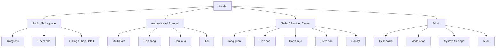
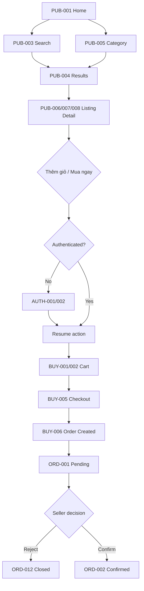
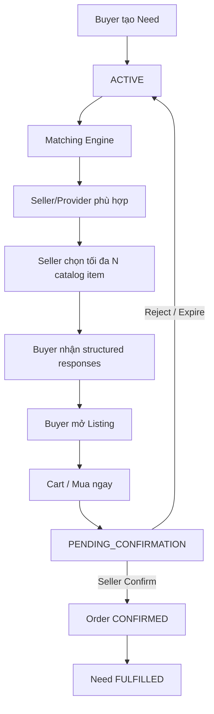
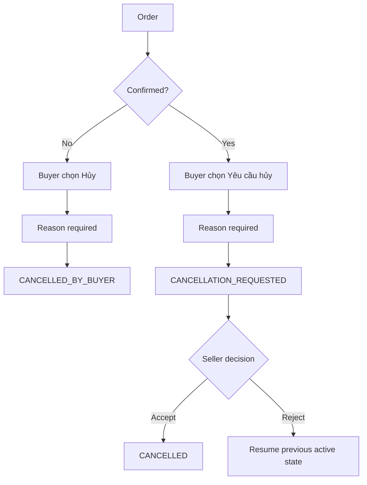
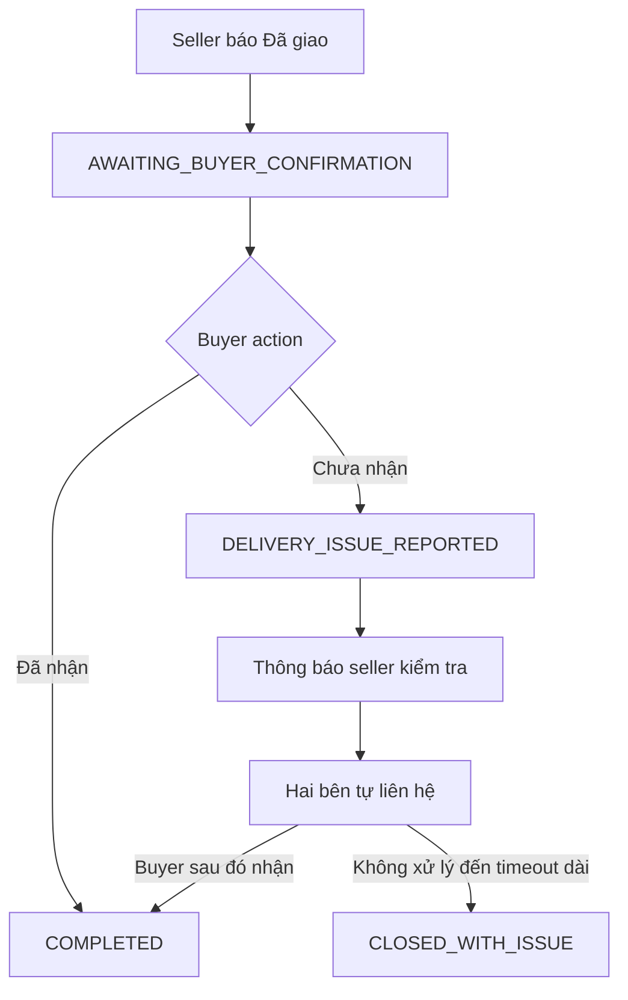
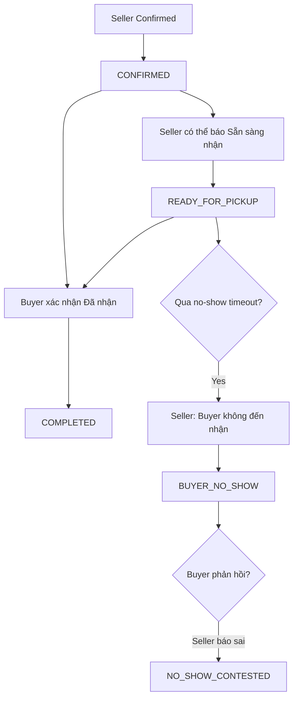
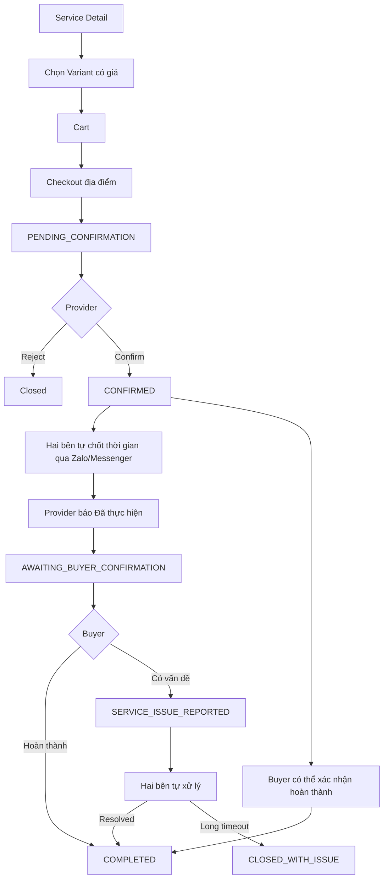

# CoVie — Information Architecture & UI Flow V1

**Phiên bản:** 1.0  
**Ngày cập nhật:** 08/08/2026  
**Tài liệu đầu vào:** `CoVie-product-plan-v0.3.md`, `CoVie-user-flow-v1.0.md`  
**Mục đích:** Chuyển User Flow V1 thành cấu trúc điều hướng, danh sách màn hình, hierarchy thông tin và wireframe logic để chuẩn bị cho UI/UX chi tiết, Database Design và API Design.  
**Quy tắc ưu tiên:** Nếu tài liệu này mâu thuẫn với User Flow V1.0 thì User Flow V1.0 được ưu tiên về business rule; tài liệu này quyết định cách tổ chức màn hình và điều hướng.

---

# 1. Mục tiêu thiết kế IA

CoVie V1 phải đạt 5 mục tiêu:

1. Guest có thể vào và tìm hàng/dịch vụ ngay, không bị chặn bởi đăng nhập.
2. Buyer tìm được seller/provider phù hợp theo vị trí, khả năng phục vụ và phí giao hàng.
3. Seller/provider thao tác đơn giản, không bị ép cập nhật quá nhiều trạng thái.
4. “Cần mua” hoạt động như hệ thống matching, không biến thành feed bài đăng lộn xộn.
5. Một account có thể vừa mua vừa bán; không tạo hai hệ thống tài khoản tách biệt.

---

# 2. Hướng kiến trúc giao diện được chọn

## 2.1. Một ứng dụng chính cho Guest / Buyer

CoVie dùng một app shell chính cho người dùng phổ thông.

**Bottom Navigation đề xuất:**

```text
┌──────────────────────────────────────┐
│                                      │
│             Nội dung trang           │
│                                      │
├──────────────────────────────────────┤
│ Trang chủ | Khám phá | Cần mua | Đơn | Tôi │
└──────────────────────────────────────┘
```

5 tab:

1. **Trang chủ** — feed theo vị trí, category, shop gần bạn.
2. **Khám phá** — search + filter + category browsing.
3. **Cần mua** — demand matching.
4. **Đơn** — đơn mua + dịch vụ.
5. **Tôi** — profile, địa chỉ, giỏ hàng, Seller Center, review/reputation.

### Lý do không đặt “Giỏ hàng” thành tab riêng

CoVie có nhiều cart theo seller location. Cart được truy cập bằng icon cố định ở header hoặc từ trang `Tôi`.

```text
Header:
[ CoVie ]      [📍 S5.03]       [🛒 3]
```

---

## 2.2. Seller / Provider Center trong cùng account

Không tạo app seller riêng ở V1.

Buyer có thể vào:

```text
Tôi
↓
Bán hàng trên CoVie
↓
Seller Center
```

Nếu account đã là seller/provider:

```text
Tôi
↓
Seller Center
```

Seller Center dùng navigation riêng:

```text
Tổng quan
Đơn hàng
Danh mục
Điểm bán
Cài đặt
```

Provider dùng cùng Seller Center; loại listing quyết định flow là Product / Thanh lý / Service.

---

## 2.3. Admin là application surface riêng

Admin không dùng mobile buyer UI.

Đề xuất route/surface riêng:

```text
/admin
```

Desktop-first sidebar:

```text
Dashboard
Users
Seller / Provider
Shops & Locations
Listings
Orders
Cần mua
Reports
Communities / Zones
Categories
Settings
Audit Log
```

---

# 3. Information Architecture tổng thể



---

# 4. Global Navigation

## 4.1. Header

Header mobile tối giản:

```text
┌───────────────────────────────────┐
│ CoVie      📍 S5.03        🛒 3  │
└───────────────────────────────────┘
```

### Logo

Tap → Trang chủ.

### Location

Tap → Location Chooser.

### Cart

Tap → Multi-Cart Overview.

Nếu guest bấm Cart:

- nếu chưa có account/cart → Login/Register;
- không duy trì guest cart.

---

## 4.2. Bottom Navigation

```text
🏠 Trang chủ
🔎 Khám phá
➕ Cần mua
📦 Đơn
👤 Tôi
```

### Guest

Guest được dùng:

- Trang chủ;
- Khám phá;
- xem listing/shop.

Bấm:

- Cần mua;
- Đơn;
- Tôi có chức năng account;

→ Login/Register nếu cần.

---

# 5. Sitemap — Buyer / Guest

```text
CoVie
│
├── Trang chủ
│   ├── Location Selector
│   ├── Search Entry
│   ├── Categories
│   ├── Gần bạn
│   ├── Đang mở
│   ├── Freeship
│   ├── Thanh lý
│   └── Dịch vụ
│
├── Khám phá
│   ├── Search
│   ├── Search Results
│   ├── Filter / Sort
│   ├── Category Results
│   └── Map/List toggle (có thể để sau V1 nếu cần giảm scope)
│
├── Listing Detail
│   ├── Product
│   ├── Thanh lý
│   └── Service
│
├── Shop / Provider
│   ├── Overview
│   ├── Products
│   ├── Services
│   ├── Thanh lý
│   └── Reputation / Reviews
│
├── Cart
│   ├── Multi-Cart Overview
│   └── Cart Detail theo Seller Location
│
├── Checkout
│   ├── Address
│   ├── Fulfillment
│   ├── Shipping
│   ├── Payment Method
│   └── Confirm Order
│
├── Đơn
│   ├── Active
│   ├── Completed
│   ├── Cancelled / Closed
│   └── Order Detail
│
├── Cần mua
│   ├── My Need Requests
│   ├── Create Need
│   ├── Need Detail
│   └── Seller Responses
│
└── Tôi
    ├── Profile
    ├── Addresses
    ├── Reputation
    ├── Reviews
    ├── Saved Contact / Settings
    └── Seller Center
```

---

# 6. Sitemap — Seller / Provider Center

```text
Seller Center
│
├── Tổng quan
│   ├── Đơn chờ xác nhận
│   ├── Đơn đang xử lý
│   ├── Cần mua phù hợp
│   └── Shop status
│
├── Đơn hàng
│   ├── Chờ xác nhận
│   ├── Đã xác nhận
│   ├── Đang giao / Ready / Đã thực hiện
│   ├── Hoàn thành
│   └── Hủy / Có vấn đề
│
├── Danh mục
│   ├── Products
│   ├── Services
│   ├── Thanh lý
│   └── Create/Edit Listing
│
├── Điểm bán
│   ├── Location List
│   ├── Create/Edit Location
│   ├── Delivery Coverage
│   ├── Shipping Policy
│   └── Minimum Order
│
└── Cài đặt
    ├── Shop Profile
    ├── Contact Methods
    ├── Zalo / Messenger Link/QR
    ├── Reputation
    └── Moderation Notices
```

---

# 7. Sitemap — Admin

```text
Admin
│
├── Dashboard
│
├── Users
│   ├── Buyer Accounts
│   ├── Seller / Provider Accounts
│   └── Account Detail
│
├── Shops & Locations
│
├── Listings
│   ├── Products
│   ├── Services
│   └── Thanh lý
│
├── Orders
│   ├── Order Detail
│   └── Status History
│
├── Cần mua
│
├── Reports
│   ├── User Reports
│   └── Listing Reports
│
├── Taxonomy
│   ├── Communities
│   ├── Zones
│   └── Categories
│
├── System Settings
│   ├── Moderation
│   ├── Reviews
│   ├── Reputation
│   ├── Order Timeouts
│   └── Need Matching
│
└── Audit Log
```

---

# 8. Screen ID Convention

Để UI, API và QA cùng tham chiếu, dùng mã màn hình:

```text
PUB-xxx   Public / Guest
AUTH-xxx  Authentication
BUY-xxx   Buyer
ORD-xxx   Order
NEED-xxx  Cần mua
SEL-xxx   Seller / Provider
ADM-xxx   Admin
SYS-xxx   Shared/System
```

---

# 9. Screen Inventory — Public / Authentication

| ID | Màn hình | Mục đích |
|---|---|---|
| PUB-001 | Home | Marketplace theo vị trí |
| PUB-002 | Location Chooser | GPS hoặc chọn thủ công |
| PUB-003 | Search | Nhập truy vấn |
| PUB-004 | Search Results | Kết quả + filter |
| PUB-005 | Category Listing | Duyệt theo category |
| PUB-006 | Product Detail | Hàng hóa |
| PUB-007 | Service Detail | Dịch vụ + variant |
| PUB-008 | Thanh lý Detail | Đồ thanh lý |
| PUB-009 | Shop / Provider Profile | Catalog + reputation |
| AUTH-001 | Login | Đăng nhập |
| AUTH-002 | Register | Đăng ký |

---

# 10. Screen Inventory — Buyer

| ID | Màn hình | Mục đích |
|---|---|---|
| BUY-001 | Multi-Cart Overview | Danh sách cart theo seller location |
| BUY-002 | Cart Detail | Item của một seller location |
| BUY-003 | Address List | Nhiều địa chỉ của buyer |
| BUY-004 | Address Create/Edit | Tạo/sửa địa chỉ |
| BUY-005 | Checkout | Xác nhận đơn |
| BUY-006 | Order Created | Kết quả đặt đơn |
| BUY-007 | My Orders | Danh sách đơn |
| BUY-008 | Profile | Account overview |
| BUY-009 | Reputation | Tỷ lệ hoàn thành của buyer |
| BUY-010 | Review Form | 1–5 sao + comment |
| BUY-011 | Report Listing/User | Report policy issue |

---

# 11. Screen Inventory — Order

| ID | Màn hình | Mục đích |
|---|---|---|
| ORD-001 | Order Detail — Pending | Chờ seller xác nhận |
| ORD-002 | Order Detail — Confirmed | Giao dịch đã bắt đầu |
| ORD-003 | Order Detail — Delivery | Theo dõi seller delivery |
| ORD-004 | Order Detail — Pickup | Theo dõi pickup |
| ORD-005 | Order Detail — Service | Theo dõi dịch vụ |
| ORD-006 | Cancellation Reason | Buyer/seller chọn lý do |
| ORD-007 | Cancellation Request | Buyer yêu cầu hủy sau confirmation |
| ORD-008 | Delivery Issue | Chưa nhận hàng |
| ORD-009 | Service Issue | Dịch vụ chưa hoàn thành |
| ORD-010 | No-show Response | Buyer phản hồi `BUYER_NO_SHOW` |
| ORD-011 | Completed Detail | Đơn hoàn thành + Review CTA |
| ORD-012 | Closed/Cancelled Detail | Terminal state |

---

# 12. Screen Inventory — Cần mua

| ID | Màn hình | Mục đích |
|---|---|---|
| NEED-001 | My Needs | Active / Fulfilled / Expired |
| NEED-002 | Create Need | Tạo nhu cầu có cấu trúc |
| NEED-003 | Need Detail | Nội dung + trạng thái |
| NEED-004 | Need Responses | Seller responses dạng catalog |
| NEED-005 | Seller Need Feed | Need phù hợp seller |
| NEED-006 | Select Catalog Item | Gửi tối đa N item phù hợp |

---

# 13. Screen Inventory — Seller / Provider

| ID | Màn hình | Mục đích |
|---|---|---|
| SEL-001 | Seller Center Dashboard | Tổng quan |
| SEL-002 | Shop Settings | Hồ sơ shop |
| SEL-003 | Location List | Nhiều điểm bán |
| SEL-004 | Location Create/Edit | Thông tin điểm bán |
| SEL-005 | Delivery Coverage | Radius / Zone |
| SEL-006 | Shipping Policy | Freeship/fixed/conditional/negotiated |
| SEL-007 | Minimum Order | Giá trị đơn tối thiểu |
| SEL-008 | Contact Settings | Zalo/Messenger |
| SEL-009 | Catalog | Product/Service/Thanh lý |
| SEL-010 | Product Create/Edit | Listing hàng hóa |
| SEL-011 | Service Create/Edit | Listing dịch vụ |
| SEL-012 | Service Variants | Variant + giá chính xác |
| SEL-013 | Thanh lý Create/Edit | Listing đồ cũ |
| SEL-014 | Incoming Orders | Đơn chờ xác nhận |
| SEL-015 | Seller Order Detail | Xử lý đơn |
| SEL-016 | Reject Reason | Lý do từ chối |
| SEL-017 | Cancel Reason | Hủy sau confirmation |
| SEL-018 | Reputation | Completion rate |
| SEL-019 | Moderation Notices | Cảnh báo/quyết định moderation |

---

# 14. Screen Inventory — Admin

| ID | Màn hình | Mục đích |
|---|---|---|
| ADM-001 | Dashboard | Operational overview |
| ADM-002 | Users | Quản lý account |
| ADM-003 | Seller/Provider | Seller accounts |
| ADM-004 | Shops & Locations | Điểm bán |
| ADM-005 | Listings | Listing management |
| ADM-006 | Order Explorer | Audit order |
| ADM-007 | Order History | Status/event history |
| ADM-008 | Need Requests | Quản lý need |
| ADM-009 | Reports Queue | Policy reports |
| ADM-010 | Moderation Settings | Auto/Pre/Hybrid |
| ADM-011 | Review Settings | ON/OFF |
| ADM-012 | Reputation Settings | Warning threshold |
| ADM-013 | Order Timeout Settings | Expiry/autocomplete/no-show |
| ADM-014 | Need Matching Settings | Response limit/defaults |
| ADM-015 | Community/Zone | Geographic taxonomy |
| ADM-016 | Category Management | Taxonomy |
| ADM-017 | Audit Log | Admin/system actions |

---

# 15. Master UI Flow — Guest → Buyer → Order



---

# 16. Home Wireframe Logic — PUB-001

```text
┌─────────────────────────────────────┐
│ CoVie        📍 S5.03        🛒 2   │
├─────────────────────────────────────┤
│ 🔎 Tìm món ăn, sản phẩm, dịch vụ... │
├─────────────────────────────────────┤
│ [Đồ ăn] [Đồ uống] [Tạp hóa] [...]  │
├─────────────────────────────────────┤
│ Gần bạn                         >   │
│ ┌──────────────┐ ┌──────────────┐  │
│ │ Product      │ │ Product      │  │
│ │ 350m         │ │ 600m         │  │
│ │ Ship 5k      │ │ Freeship     │  │
│ └──────────────┘ └──────────────┘  │
├─────────────────────────────────────┤
│ Đang mở                         >   │
│ ...                                 │
├─────────────────────────────────────┤
│ Dịch vụ gần bạn                 >   │
│ ...                                 │
├─────────────────────────────────────┤
│ Thanh lý gần bạn                >   │
│ ...                                 │
├─────────────────────────────────────┤
│ 🏠       🔎       ➕       📦     👤 │
└─────────────────────────────────────┘
```

## Priority trên card

Card không nên nhồi quá nhiều dữ liệu.

Hiển thị ưu tiên:

1. Ảnh.
2. Tên.
3. Giá.
4. Khoảng cách.
5. Delivery status/phí ship.
6. Rating hoặc completion rate nếu cần.

---

# 17. Search Results Wireframe — PUB-004

```text
┌─────────────────────────────────────┐
│ ←  "trà sữa"                 Filter│
├─────────────────────────────────────┤
│ Giao tới tôi ✓ | Đang mở | Freeship│
├─────────────────────────────────────┤
│ Sắp xếp: Phù hợp nhất ▼             │
├─────────────────────────────────────┤
│ [ảnh] Trà sữa Mina                  │
│      30.000đ                         │
│      📍350m · 🚚5k · ⭐4.9          │
├─────────────────────────────────────┤
│ [ảnh] Tea House                     │
│      35.000đ                         │
│      📍600m · 🎁Freeship            │
└─────────────────────────────────────┘
```

## Filter Sheet

- Giao tới vị trí của tôi.
- Khoảng cách.
- Phí ship.
- Freeship.
- Đang mở.
- Category.
- Giá.
- Rating.
- Community/Zone.

---

# 18. Product Detail Wireframe — PUB-006

```text
┌─────────────────────────────────────┐
│ ←                           Share   │
│                                     │
│            [ẢNH]                    │
│                                     │
├─────────────────────────────────────┤
│ Coca-Cola 1.5L                      │
│ 18.000đ                             │
│ ⭐ 4.9                              │
├─────────────────────────────────────┤
│ Tạp hóa Minh                        │
│ 📍 350m · Completion 98%            │
│ [Xem shop]                          │
├─────────────────────────────────────┤
│ 🚚 Giao tới bạn                     │
│ Phí ship: 5.000đ                    │
│ hoặc rule freeship                  │
├─────────────────────────────────────┤
│ Mô tả                               │
│ ...                                 │
├─────────────────────────────────────┤
│ [Thêm vào giỏ]      [Mua ngay]     │
└─────────────────────────────────────┘
```

Nếu seller completion dưới threshold:

```text
⚠ Tỷ lệ hoàn thành đơn của shop thấp: 72%
```

Không hiển thị lịch sử đơn chi tiết.

---

# 19. Service Detail Wireframe — PUB-007

Dịch vụ dùng variant có **giá xác định**.

```text
┌─────────────────────────────────────┐
│ Vệ sinh máy lạnh                    │
│ Nhà Sạch 24H                        │
├─────────────────────────────────────┤
│ Phân loại                           │
│ ○ 1 máy                 150.000đ    │
│ ● 2 máy                 280.000đ    │
│ ○ 3 máy                 400.000đ    │
├─────────────────────────────────────┤
│ 📍 Phục vụ tới địa chỉ của bạn ✓    │
│                                     │
│ Thời gian thực hiện sẽ được hai bên │
│ liên hệ thống nhất sau khi Provider │
│ xác nhận đơn.                       │
├─────────────────────────────────────┤
│ [Thêm vào giỏ]      [Đặt dịch vụ]  │
└─────────────────────────────────────┘
```

Không có:

- “Giá từ”.
- “Inbox để biết giá”.
- Calendar booking trong V1.

---

# 20. Multi-Cart UX — BUY-001

Một buyer có nhiều cart, nhưng mỗi cart thuộc **một seller/provider location** và **một commerce type** (`PRODUCT` hoặc `SERVICE`). Product/thanh lý không trộn với service trong cùng cart.

```text
GIỎ HÀNG

Bếp Nhà Mai — S10.03
2 sản phẩm · 120.000đ
[ Xem giỏ ]

Tạp hóa Hân — S7.02
3 sản phẩm · 51.000đ
[ Xem giỏ ]

Nhà Sạch 24H — Location A
2 dịch vụ · 630.000đ
[ Xem giỏ ]
```

Không checkout nhiều seller trong một order.

---

# 21. Cart Detail — BUY-002

```text
┌─────────────────────────────────────┐
│ ← Bếp Nhà Mai — S10.03             │
├─────────────────────────────────────┤
│ Cơm gà                              │
│ 45.000đ                [-] 2 [+]    │
│                                     │
│ Trà đào                             │
│ 30.000đ                [-] 1 [+]    │
├─────────────────────────────────────┤
│ Tiền hàng                120.000đ   │
│ Ship                  tính checkout │
├─────────────────────────────────────┤
│                [Tiếp tục đặt hàng] │
└─────────────────────────────────────┘
```

Nếu product price thay đổi sau khi add cart:

- checkout phải refresh giá;
- thông báo buyer;
- buyer xác nhận giá mới trước order creation.

---

# 22. Checkout — BUY-005

```text
┌─────────────────────────────────────┐
│ ← Xác nhận đơn                      │
├─────────────────────────────────────┤
│ Địa chỉ giao                        │
│ S5.03 - Sảnh chính             >    │
├─────────────────────────────────────┤
│ Nhận hàng                           │
│ ● Seller giao                       │
│ ○ Tự lấy                            │
├─────────────────────────────────────┤
│ Sản phẩm                            │
│ ...                                 │
├─────────────────────────────────────┤
│ Phí giao                            │
│ 5.000đ                              │
│ hoặc "Thỏa thuận với người bán"    │
├─────────────────────────────────────┤
│ Thanh toán                          │
│ ● COD                               │
│ ○ Chuyển khoản — tự thỏa thuận      │
├─────────────────────────────────────┤
│ Tiền hàng                120.000đ   │
│ Phí ship                    5.000đ   │
│ Tổng                      125.000đ   │
├─────────────────────────────────────┤
│                    [Đặt hàng]      │
└─────────────────────────────────────┘
```

## Negotiated Shipping

Không hiển thị:

```text
Ship: 0đ
```

Phải hiển thị:

```text
Phí giao: Thỏa thuận với người bán
```

Nếu phí thỏa thuận ngoài CoVie, total trong hệ thống chỉ được gọi là:

```text
Tạm tính trên CoVie
```

không khẳng định đó là tổng tiền cuối cùng hai bên sẽ trao đổi.

---

# 23. Order Detail — cấu trúc chung

Order Detail phải là **state-driven screen**, không tạo một page riêng hoàn toàn cho mỗi status.

```text
┌─────────────────────────────────────┐
│ ← Đơn #CV001                        │
│ [STATUS CHIP]                       │
├─────────────────────────────────────┤
│ Timeline / trạng thái hiện tại      │
├─────────────────────────────────────┤
│ Shop + Contact                      │
│ [Zalo] [Messenger]                  │
├─────────────────────────────────────┤
│ Địa điểm                            │
├─────────────────────────────────────┤
│ Items                               │
├─────────────────────────────────────┤
│ Payment / Shipping                  │
├─────────────────────────────────────┤
│ Primary CTA                         │
│ Secondary CTA                       │
└─────────────────────────────────────┘
```

---

# 24. Buyer Order CTA Matrix

## Product — Seller Delivery

| Status | Buyer Primary CTA | Secondary |
|---|---|---|
| `PENDING_CONFIRMATION` | Hủy đơn | Liên hệ seller |
| `CONFIRMED` | Đã nhận hàng | Yêu cầu hủy, Liên hệ |
| `OUT_FOR_DELIVERY` | Đã nhận hàng | Liên hệ |
| `AWAITING_BUYER_CONFIRMATION` | Đã nhận hàng | Chưa nhận được hàng |
| `DELIVERY_ISSUE_REPORTED` | Đã nhận hàng | Liên hệ seller |
| `COMPLETED` | Đánh giá nếu enabled | Xem shop |

**Rule:** `Chưa nhận được hàng` chỉ hiện sau khi seller báo `Đã giao`.

---

## Product — Pickup

| Status | Buyer Primary CTA | Secondary |
|---|---|---|
| `PENDING_CONFIRMATION` | Hủy đơn | Liên hệ |
| `CONFIRMED` | Đã nhận hàng | Yêu cầu hủy |
| `READY_FOR_PICKUP` | Đã nhận hàng | Liên hệ |
| `BUYER_NO_SHOW` | Tôi đã đến nhận / Seller báo sai | Liên hệ |
| `NO_SHOW_CONTESTED` | Liên hệ seller | — |
| `COMPLETED` | Đánh giá nếu enabled | — |

---

## Service

| Status | Buyer Primary CTA | Secondary |
|---|---|---|
| `PENDING_CONFIRMATION` | Hủy đơn | Liên hệ |
| `CONFIRMED` | Dịch vụ đã hoàn thành | Yêu cầu hủy, Liên hệ |
| `AWAITING_BUYER_CONFIRMATION` | Đã hoàn thành | Dịch vụ chưa hoàn thành / Có vấn đề |
| `SERVICE_ISSUE_REPORTED` | Đã hoàn thành | Liên hệ provider |
| `COMPLETED` | Đánh giá nếu enabled | — |

---

# 25. Seller Order Detail — SEL-015

Seller UI cũng state-driven.

```text
┌─────────────────────────────────────┐
│ Đơn #CV001                          │
│ Chờ xác nhận                        │
├─────────────────────────────────────┤
│ Buyer                               │
│ Completion rate: 96%                │
│ [warning nếu dưới threshold]        │
├─────────────────────────────────────┤
│ Items                               │
├─────────────────────────────────────┤
│ Delivery address                    │
│ Shipping policy snapshot            │
├─────────────────────────────────────┤
│ [Từ chối]          [Xác nhận đơn]  │
└─────────────────────────────────────┘
```

Sau `CONFIRMED`, seller delivery:

```text
[Đang giao]
[Đã giao]
[Hủy đơn]
[Liên hệ buyer]
```

Không bắt seller phải qua mọi intermediate state.

Buyer vẫn có thể hoàn thành từ `CONFIRMED` nếu thực tế đã nhận hàng.

---

# 26. Pickup Seller UI

Sau confirmation:

```text
[ Sẵn sàng nhận ]
```

không bắt buộc.

Sau `READY_FOR_PICKUP` và hết timeout Admin cấu hình:

```text
[ Buyer không đến nhận ]
```

→ `BUYER_NO_SHOW`.

---

# 27. Service Seller/Provider UI

Provider nhận order:

```text
YÊU CẦU DỊCH VỤ

Vệ sinh máy lạnh — 2 máy
280.000đ

Vệ sinh sofa — Sofa chữ L
350.000đ

Địa điểm: S5.03

[ Từ chối ] [ Xác nhận ]
```

Sau confirmation:

```text
Đã xác nhận.
Hãy liên hệ Buyer để thống nhất thời gian thực hiện.

[ Zalo ] [ Messenger ]

[ Đã thực hiện ]
[ Hủy đơn ]
```

Buyer không cần chờ provider bấm `Đã thực hiện` mới được xác nhận hoàn thành.

---

# 28. “Cần mua” IA

“Cần mua” có tab riêng vì đây là core differentiator của CoVie.

```text
Cần mua
│
├── Đang cần
├── Đã tìm được
├── Hết hạn
└── [+ Tạo yêu cầu]
```

Không có comment thread tự do.

---

# 29. Create Need — NEED-002

```text
┌─────────────────────────────────────┐
│ ← Tôi đang cần                      │
├─────────────────────────────────────┤
│ Tên / nhu cầu                       │
│ [ Coca-Cola 1.5L ]                  │
├─────────────────────────────────────┤
│ Category                            │
│ [ Đồ uống ▼ ]                       │
├─────────────────────────────────────┤
│ Số lượng                            │
│ [ 2 ]                               │
├─────────────────────────────────────┤
│ Vị trí                              │
│ S5.03                               │
├─────────────────────────────────────┤
│ Phạm vi tìm                         │
│ [ 3 km ▼ ]                          │
├─────────────────────────────────────┤
│ Thời hạn                            │
│ 1h | 3h | Hết ngày | 24h            │
├─────────────────────────────────────┤
│                [Đăng Cần mua]      │
└─────────────────────────────────────┘
```

Giá mong muốn có thể để optional nếu giữ trong V1; không dùng nó làm điều kiện bắt buộc matching ban đầu.

---

# 30. Need Matching Flow



---

# 31. Need Responses — NEED-004

```text
Coca-Cola 1.5L × 2
📍 S5.03
Còn 2h 14m

5 shop đã phản hồi

┌─────────────────────────────────────┐
│ Tạp hóa Minh                        │
│ Coca-Cola 1.5L                      │
│ 18.000đ                             │
│ 350m · Ship 5k                      │
│ [Xem sản phẩm]                      │
└─────────────────────────────────────┘

┌─────────────────────────────────────┐
│ Shop Hân                            │
│ Coca-Cola 1.5L                      │
│ 17.000đ                             │
│ 600m · Freeship                     │
│ [Xem sản phẩm]                      │
└─────────────────────────────────────┘
```

Seller không được gõ quảng cáo/comment tự do vào Need.

---

# 32. Seller Need Feed — NEED-005

Seller Center có block:

```text
CẦN MUA PHÙ HỢP

Coca-Cola 1.5L × 2
📍 600m
Còn 2h

Bạn có 2 sản phẩm có thể phù hợp

[ Gửi sản phẩm ]
```

Seller chọn tối đa số item do Admin cấu hình, mặc định 3.

---

# 33. External Contact UX

V1 không xây realtime chat.

Seller/provider cấu hình:

```text
Zalo
- Link profile / chat
- hoặc QR liên hệ

Messenger
- Link
- hoặc QR liên hệ nếu phù hợp
```

Trên Order Detail:

```text
Liên hệ người bán
[ Zalo ] [ Messenger ]
```

### Phân biệt Contact QR và Payment QR

CoVie V1:

- có thể cho seller upload QR **liên hệ**;
- không lưu/upload QR **thanh toán ngân hàng**.

UI phải ghi rõ mục đích để tránh nhầm lẫn.

---

# 34. Review UX

Review chỉ xuất hiện nếu:

```text
order.status == COMPLETED
AND
Admin.reviewSystemEnabled == true
```

Wireframe:

```text
Đánh giá giao dịch

☆ ☆ ☆ ☆ ☆

Bình luận (không bắt buộc)
[................................]

[ Gửi đánh giá ]
```

Nếu Admin tắt Review:

- không hiện Review CTA;
- review cũ giữ trong database;
- UI public có thể ẩn rating/review theo policy cấu hình.

---

# 35. Reputation UX

Buyer thấy seller/provider:

```text
Tỷ lệ hoàn thành: 97%
```

Seller thấy buyer:

```text
Tỷ lệ hoàn thành: 95%
```

Nếu dưới threshold Admin:

```text
⚠ Tỷ lệ hoàn thành giao dịch thấp
72%
```

Không hiển thị:

- buyer đã mua gì;
- seller đã hủy đơn nào;
- lịch sử chi tiết của đối phương.

---

# 36. Location UX

## Browse location

Ưu tiên:

```text
Browser GPS
↓ nếu từ chối
Manual Location Selection
```

Dùng để:

- xếp hạng gần bạn;
- kiểm tra delivery coverage;
- ước tính shipping rule.

## Order address

Buyer lưu nhiều địa chỉ:

```text
Nhà
Công ty
Sảnh S5.03
...
```

Mỗi order chỉ snapshot **một buyer address** và **một seller/provider location**.

Các thỏa thuận chi tiết hơn như “giao lên căn hộ” nằm ngoài core order data V1.

---

# 37. Seller Location UX

Một seller có nhiều location.

```text
Điểm bán

S10.03
🟢 Đang mở
Delivery: 2 km
[Chỉnh sửa]

S7.02
🔴 Tạm nghỉ
Zones: Origami, Rainbow
[Chỉnh sửa]

[+ Thêm điểm bán]
```

Mỗi location có riêng:

- địa chỉ;
- trạng thái;
- coverage;
- shipping policy;
- minimum order;
- contact nếu muốn override shop default.

---

# 38. Delivery Coverage UI — SEL-005

```text
PHẠM VI PHỤC VỤ

○ Theo bán kính
  [ 2 ] km

○ Theo khu vực
  ☑ The Origami
  ☑ The Rainbow
  ☐ The Beverly

○ Kết hợp bán kính + khu vực
```

Không đặt hard limit business ở V1, nhưng UI có preset hợp lý:

```text
500m / 1km / 2km / 3km / 5km / 10km / Tùy chỉnh
```

---

# 39. Shipping Policy UI — SEL-006

```text
PHÍ GIAO HÀNG

○ Freeship

○ Phí cố định
  [ 10.000 ] đ

○ Theo điều kiện
  Phí mặc định: [10.000] đ

  Freeship khi:
  ☑ Khoảng cách ≤ [1] km
  ☑ Đơn hàng ≥ [150.000] đ

  Logic:
  ○ Bất kỳ điều kiện nào đúng
  ○ Tất cả điều kiện phải đúng

○ Thỏa thuận với người mua
```

## Minimum Order

```text
☑ Yêu cầu đơn tối thiểu để giao
[ 50.000 ] đ
```

Pickup không bị minimum delivery order chặn nếu seller cho pickup.

---

# 40. Seller Dashboard — SEL-001

```text
SELLER CENTER

Shop: Bếp Nhà Mai ▼
Location: S10.03 ▼

┌────────────────────┐
│ 4 đơn chờ xác nhận │
└────────────────────┘

┌────────────────────┐
│ 7 đơn đang xử lý   │
└────────────────────┘

Cần mua phù hợp
3 yêu cầu mới

Shop status
🟢 Đang mở

[Đơn hàng] [Danh mục]
[Điểm bán] [Cài đặt]
```

MVP dashboard ưu tiên **actionable items**, không cần chart phức tạp.

---

# 41. Admin Dashboard IA

Admin V1 là control plane, không phải BI dashboard lớn.

Ưu tiên:

1. report cần xử lý;
2. listing/account bị flag;
3. moderation queue nếu bật pre-approval;
4. system settings;
5. audit log.

Không cần revenue dashboard trong V1 vì CoVie chưa xử lý payment/transaction fee.

---

# 42. Admin Settings — cấu hình bắt buộc

## Order

- Pending confirmation expiry.
- Buyer confirmation auto-complete timeout.
- Issue long-close timeout.
- Pickup no-show eligibility timeout.

## Reputation

- Warning threshold, ví dụ `<80%`.

## Review

- Review System ON/OFF.

## Need Matching

- Max catalog responses per seller/request, mặc định 3.
- Preset expiry choices nếu muốn cấu hình.

## Moderation

```text
AUTO_PUBLISH
PRE_APPROVAL
HYBRID
```

Có thể mở rộng theo category/community sau này.

---

# 43. UI State Principles

## 43.1. Không dùng status code thô trên UI

Backend:

```text
AWAITING_BUYER_CONFIRMATION
```

UI:

```text
Người bán báo đã giao
Hãy xác nhận khi bạn đã nhận được hàng.
```

## 43.2. Luôn có một Primary CTA rõ ràng

Không đặt 4–5 nút cùng trọng số.

Ví dụ:

```text
[ Đã nhận hàng ]        ← primary
Yêu cầu hủy             ← text/secondary
Liên hệ seller          ← secondary
```

## 43.3. Hành động phá hủy cần xác nhận

- Hủy đơn.
- Từ chối đơn.
- Seller cancel.
- Buyer xác nhận completed.
- No-show.

## 43.4. Completed không hoàn tác

Khi buyer xác nhận:

```text
Bạn xác nhận đã nhận hàng?
Sau khi xác nhận, đơn sẽ được hoàn tất và không thể hoàn tác.
```

---

# 44. Responsive Strategy

## Mobile first

CoVie consumer UX ưu tiên mobile vì traffic có thể đến từ Facebook/Zalo.

### Mobile

- bottom nav;
- sticky primary CTA;
- bottom sheet filter;
- cards 1–2 columns tùy width.

### Desktop buyer

- top navigation thay bottom nav hoặc giữ responsive nav;
- sidebar filters trên search;
- wider catalog grid.

### Seller Center

- mobile usable;
- desktop/tablet thuận tiện hơn cho quản lý catalog.

### Admin

- desktop-first.

---

# 45. Route Map đề xuất

Route chỉ mang tính IA, chưa chốt framework implementation.

```text
/
/search
/category/:slug
/product/:id
/service/:id
/listing/:id
/shop/:slug

/login
/register

/cart
/cart/:locationId
/checkout/:cartId

/orders
/orders/:orderId

/needs
/needs/new
/needs/:needId

/account
/account/addresses
/account/reputation

/seller
/seller/orders
/seller/orders/:orderId
/seller/catalog
/seller/products/new
/seller/services/new
/seller/locations
/seller/locations/:id
/seller/settings

/admin
/admin/users
/admin/sellers
/admin/shops
/admin/listings
/admin/orders
/admin/needs
/admin/reports
/admin/settings/*
/admin/audit
```

---

# 46. Shared UI Components

Các component nên được thiết kế reusable:

1. `LocationSelector`
2. `SearchBar`
3. `CategoryChip`
4. `ListingCard`
5. `ShopCard`
6. `DeliveryBadge`
7. `ShippingLabel`
8. `CompletionRateBadge`
9. `WarningBanner`
10. `VariantSelector`
11. `QuantitySelector`
12. `CartSummary`
13. `OrderStatusHeader`
14. `OrderTimeline`
15. `PrimaryActionBar`
16. `ExternalContactButtons`
17. `NeedCard`
18. `NeedResponseCard`
19. `ReasonSelector`
20. `ReviewStars`
21. `SellerLocationSelector`
22. `ModerationStatusBadge`

---

# 47. Empty / Loading / Error States cần thiết kế

Không chỉ thiết kế happy path.

## Search empty

```text
Không tìm thấy sản phẩm phù hợp gần bạn.
[Đăng Cần mua]
```

Đây là opportunity để chuyển search failure thành demand matching.

## No delivery

```text
Shop này chưa giao tới địa chỉ của bạn.

Nếu shop hỗ trợ:
[ Chọn tự lấy ]
```

## Seller not responding

```text
Seller chưa xác nhận đơn và thời gian chờ đã hết.

[ Tìm sản phẩm tương tự ]
```

## Need no response

```text
Chưa có shop phù hợp phản hồi.
Yêu cầu vẫn còn hiệu lực trong 2h 15m.
```

## Review disabled

Không hiện lỗi; đơn giản không render Review CTA.

---

# 48. Notification Deep Links

Mỗi notification phải mở đúng màn hình liên quan.

Ví dụ:

```text
Đơn đã được xác nhận
→ /orders/:id
```

```text
Seller báo đã giao
→ /orders/:id
CTA: Đã nhận / Chưa nhận
```

```text
Có shop phản hồi Cần mua
→ /needs/:id
```

```text
Có đơn mới
→ /seller/orders/:id
```

---

# 49. UI Flow — Cancellation



Seller cancel sau confirmation:

```text
Seller → Hủy đơn → Reason Required → CANCELLED_BY_SELLER
```

→ ảnh hưởng seller completion rate.

---

# 50. UI Flow — Delivery Issue



CoVie không render UI kiểu:

```text
Mở tranh chấp
Admin phân xử
```

trong V1.

---

# 51. UI Flow — Pickup No-show



---

# 52. UI Flow — Service



---

# 53. MVP Screen Priority

## P0 — bắt buộc để end-to-end chạy được

- Home.
- Location chooser.
- Search/results.
- Product detail.
- Service detail.
- Thanh lý detail.
- Shop detail.
- Login/Register.
- Cart.
- Address.
- Checkout.
- Orders + Order Detail.
- Seller Center.
- Location configuration.
- Product/Service/Thanh lý CRUD.
- Seller incoming order flow.
- Cần mua create/match/response.
- Admin settings tối thiểu.
- Report.

## P1 — cần cho V1 public tốt hơn

- Review.
- Reputation UI.
- Advanced conditional shipping UI.
- Need matching refinements.
- Moderation queue UI.

## P2 — có thể hoãn nếu launch cần nhanh

- Map/list toggle.
- Advanced analytics seller.
- Rich seller storefront customization.
- Saved/favorite listings.

---

# 54. Những quyết định UI đã khóa

1. Guest browse không login.
2. Add-to-cart yêu cầu login.
3. Không guest cart.
4. Một user có nhiều cart theo seller/provider location.
5. Một cart checkout thành một order.
6. Buyer lưu nhiều địa chỉ.
7. Service có variant và giá chính xác.
8. Service không đặt lịch trong CoVie V1.
9. External contact qua Zalo/Messenger.
10. Không upload QR ngân hàng V1.
11. Buyer có thể chủ động complete sau confirmation.
12. Issue CTA chỉ hiện sau seller/provider tuyên bố hoàn tất.
13. Review chỉ cho `COMPLETED` và Admin có thể ON/OFF.
14. Completion rate hiển thị hai chiều.
15. `Cần mua` là structured matching, không có comment thread tự do.
16. Seller có nhiều location.
17. Delivery coverage hỗ trợ radius/zone.
18. Shipping V1 hỗ trợ freeship, fixed fee, conditional và negotiated.
19. Moderation mode Admin cấu hình.
20. Admin không đóng vai trò trọng tài tranh chấp V1.

---

# 55. UX Invariants để chuyển sang implementation

1. Mọi Listing CTA phải biết `listing type` và `seller location`.
2. Mọi Cart phải biết `seller/provider location`.
3. Mọi Order phải snapshot location, item, variant, price và shipping policy tại checkout.
4. UI không được suy luận `negotiated shipping == 0`.
5. UI chỉ render action được backend cho phép ở trạng thái hiện tại.
6. Buyer completion action không phụ thuộc seller/provider completion action sau `CONFIRMED`.
7. Issue action chỉ khả dụng sau seller/provider declared completion.
8. Review CTA chỉ dựa trên backend eligibility + Admin flag.
9. Completion warning threshold phải lấy từ server config.
10. Need response limit phải lấy từ server config.
11. Moderation behavior không hard-code trong client.
12. Timeout countdown phải dựa trên server timestamp, không tin client clock.

---

# 56. Bước tiếp theo sau tài liệu này

Sau khi IA/UI Flow được duyệt:

```text
Product Plan V0.3
        ↓
User Flow V1.0
        ↓
Information Architecture & UI Flow V1.0
        ↓
Database Domain Model
        ↓
ERD
        ↓
API Contract
        ↓
Technical Architecture
        ↓
Implementation Plan
```

Trước Database Design, các màn hình có thể được chuyển thành wireframe hình ảnh/Figma-style mockup nếu cần kiểm chứng UX trực quan.

---

# 57. Kết luận

CoVie V1 sử dụng một **consumer app shell thống nhất** cho Guest/Buyer và một **Seller Center** trong cùng account. Mọi giao dịch được tổ chức quanh `seller/provider location`, cho phép CoVie hỗ trợ nhiều điểm bán, delivery rule riêng, nhiều cart nhưng giữ mỗi order độc lập.

UI phải làm rõ ba giá trị cốt lõi:

1. **Ở gần tôi không?**
2. **Có phục vụ/giao tới tôi không?**
3. **Tôi có thể giao dịch với người này một cách rõ ràng không?**

“Cần mua” đóng vai trò nối cầu chủ động giữa buyer demand và seller catalog, trong khi Order Detail là state-driven UI giúp hệ thống giữ business logic rõ ràng nhưng không tạo quá nhiều thao tác cho seller/provider.
