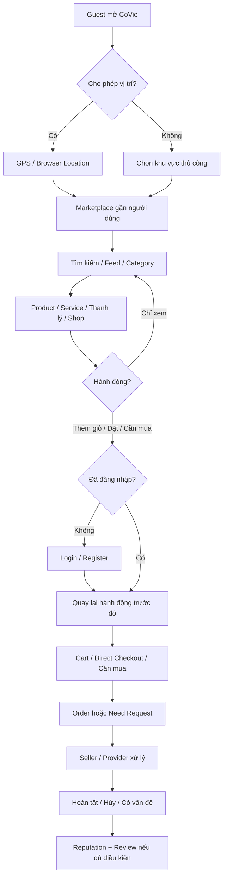
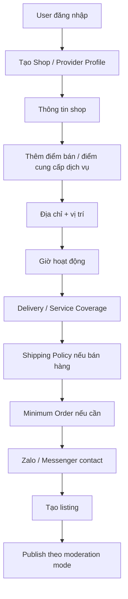
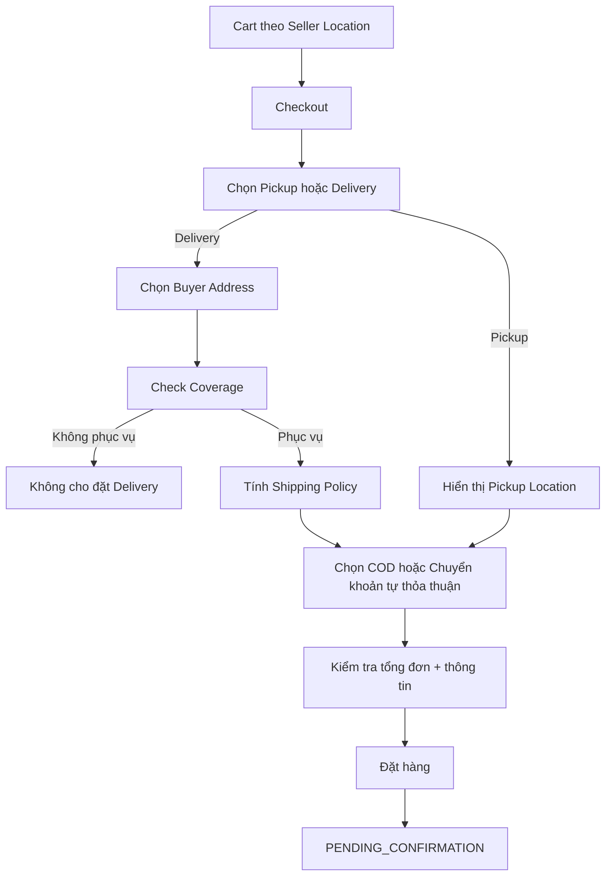
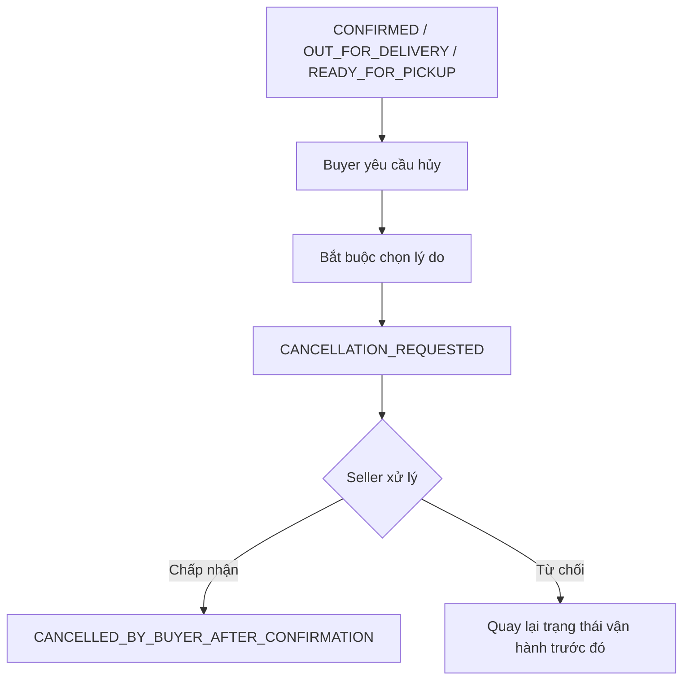
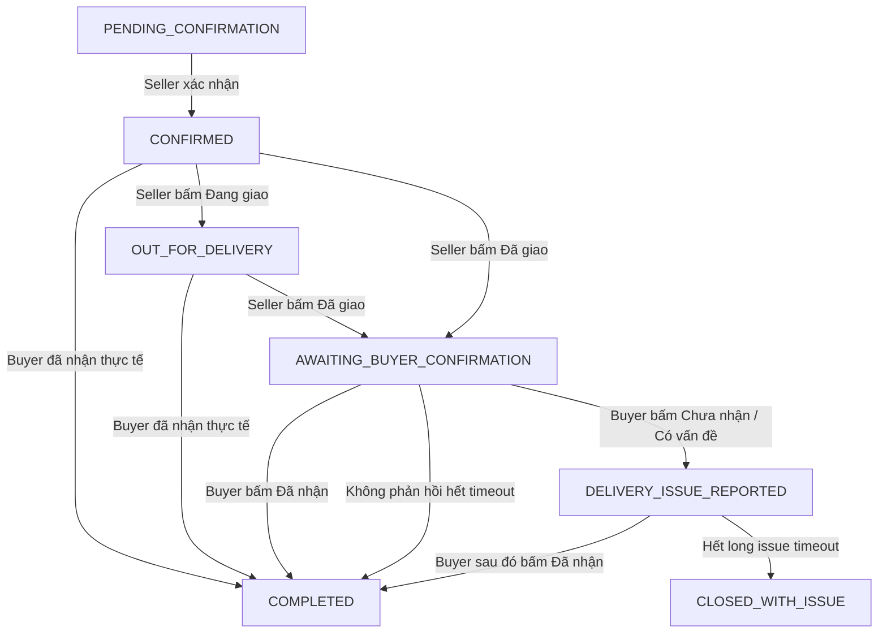
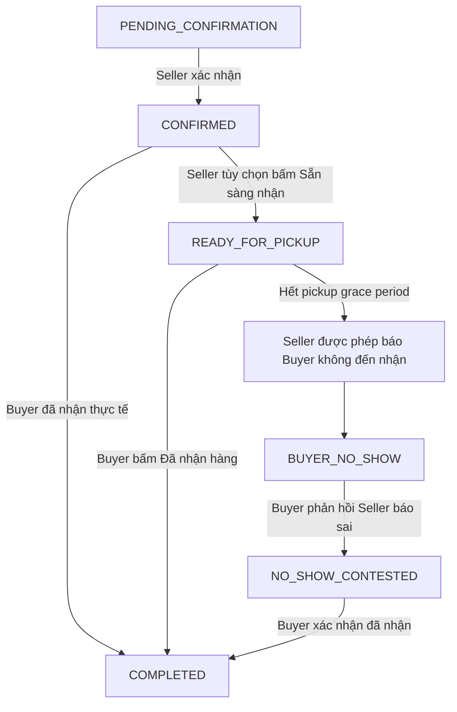
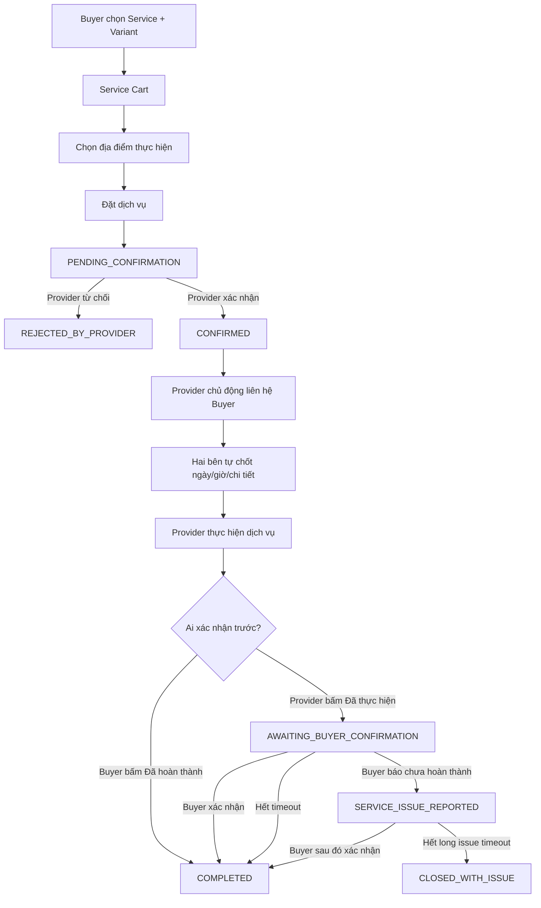
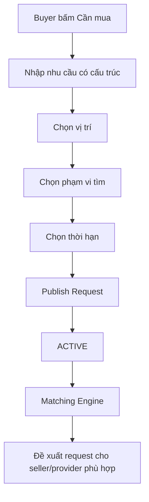

# CoVie — User Flow V1

**Phiên bản:** 1.0  
**Ngày cập nhật:** 08/08/2026  
**Tài liệu liên quan:** `CoVie-product-plan-v0.3.md`  
**Mục đích:** Chốt hành vi người dùng và vòng đời giao dịch của CoVie V1 trước khi chuyển sang UI/UX, Database Design và API Design.  
**Quy tắc ưu tiên:** Nếu tài liệu này mâu thuẫn với `CoVie-product-plan-v0.3.md`, các quyết định trong User Flow V1.0 được ưu tiên vì phản ánh các quyết định mới hơn đã chốt sau V0.3.

---

# 1. Phạm vi tài liệu

Tài liệu này mô tả toàn bộ User Flow V1 của CoVie cho các nhóm:

- Guest — người chưa đăng nhập;
- Buyer — người mua;
- Seller — người bán hàng hóa/thanh lý;
- Provider — người cung cấp dịch vụ;
- Admin — người quản trị CoVie.

Các luồng được thiết kế theo nguyên tắc:

1. **Guest có thể duyệt marketplace tự do.**
2. **Chỉ yêu cầu đăng nhập khi bắt đầu hành động cần lưu dữ liệu theo user.**
3. **CoVie V1 không đứng giữa dòng tiền.** COD hoặc chuyển khoản do buyer/seller tự thỏa thuận.
4. **CoVie V1 không xây chat realtime nội bộ.** Hai bên liên hệ qua Zalo/Messenger do seller/provider cung cấp.
5. **CoVie không đóng vai trò trọng tài tranh chấp trong V1.** Hệ thống chỉ ghi nhận trạng thái có vấn đề và hỗ trợ hai bên tự liên hệ xử lý.
6. **Seller/provider phải xác nhận đơn trước khi giao dịch được xem là đã bắt đầu.**
7. **Seller/provider không được trở thành điểm khóa khiến buyer không thể tự xác nhận hoàn thành.**
8. **Đánh giá chỉ áp dụng cho giao dịch `COMPLETED` và có thể bị Admin bật/tắt toàn hệ thống.**
9. **Uy tín giao dịch được đo hai chiều bằng tỷ lệ hoàn thành, không công khai lịch sử chi tiết.**
10. **“Cần mua” là demand-matching có cấu trúc, không phải một feed bài đăng tự do giống Facebook.**

---

# 2. Các Actor chính

## 2.1. Guest

Có thể:

- xem trang chủ;
- duyệt category;
- tìm kiếm;
- xem shop/provider;
- xem sản phẩm/dịch vụ/thanh lý;
- xem vị trí tương đối;
- xem khả năng giao tới vị trí hiện tại;
- xem phí ship dự kiến theo rule của seller;
- dùng GPS trình duyệt hoặc chọn vị trí thủ công.

Không thể:

- thêm vào giỏ;
- đặt hàng;
- đăng “Cần mua”;
- tạo shop;
- đánh giá;
- quản lý địa chỉ;
- lưu dữ liệu giao dịch.

Khi Guest thực hiện một hành động cần account, CoVie yêu cầu đăng nhập/đăng ký.

---

## 2.2. Buyer

Có toàn bộ quyền của Guest và thêm:

- lưu nhiều địa chỉ;
- thêm sản phẩm/dịch vụ vào giỏ;
- có nhiều giỏ theo seller/provider location;
- checkout;
- đặt hàng;
- đặt dịch vụ;
- hủy/yêu cầu hủy;
- xác nhận đã nhận hàng / dịch vụ hoàn thành;
- báo chưa nhận hàng / dịch vụ chưa hoàn thành khi đủ điều kiện;
- đăng “Cần mua”;
- nhận phản hồi matching từ seller/provider;
- đánh giá giao dịch `COMPLETED` nếu Review System đang bật.

---

## 2.3. Seller

Có thể:

- tạo shop;
- tạo nhiều điểm bán;
- cấu hình từng điểm bán;
- đăng sản phẩm;
- đăng đồ thanh lý;
- cấu hình delivery coverage;
- cấu hình shipping policy;
- cấu hình minimum order;
- nhận/từ chối đơn;
- cập nhật tiến trình giao hàng;
- phản hồi yêu cầu “Cần mua” bằng item trong catalog;
- xem tỷ lệ hoàn thành của buyer;
- nhận cảnh báo buyer có tỷ lệ hoàn thành dưới ngưỡng Admin cấu hình.

Seller không bắt buộc là cư dân và không bắt buộc xác minh cư dân.

---

## 2.4. Provider

Provider dùng gần như cùng tài khoản seller nhưng cung cấp **dịch vụ**.

Có thể:

- tạo nhiều provider location;
- đăng dịch vụ;
- tạo variant/phân loại dịch vụ với giá chính xác;
- xác định khu vực phục vụ;
- nhận/từ chối yêu cầu dịch vụ;
- liên hệ buyer để tự chốt thời gian thực hiện;
- đánh dấu dịch vụ đã thực hiện;
- phản hồi “Cần mua” bằng dịch vụ trong catalog.

---

## 2.5. Admin

Có thể:

- quản lý user;
- quản lý seller/provider;
- quản lý shop/location;
- quản lý listing;
- quản lý category/community/zone;
- cấu hình moderation;
- cấu hình Review System;
- cấu hình các timeout;
- cấu hình ngưỡng cảnh báo tỷ lệ hoàn thành;
- cấu hình giới hạn phản hồi “Cần mua”;
- xử lý report về user/listing;
- hide/remove listing;
- suspend/ban account.

Admin V1 **không xử lý phán quyết tranh chấp giao dịch**.

---

# 3. Master User Flow



---

# 4. Guest & Authentication Flow

## 4.1. Lần đầu mở CoVie

```text
Mở CoVie
↓
CoVie đề nghị truy cập vị trí
├── Đồng ý → lấy GPS/browser location
└── Từ chối → yêu cầu chọn khu vực thủ công
↓
Hiển thị marketplace phù hợp
```

Không bắt Guest đăng nhập ở bước này.

## 4.2. Trigger yêu cầu đăng nhập

Các hành động sau yêu cầu account:

- `Thêm vào giỏ`;
- `Mua ngay`;
- `Đăng Cần mua`;
- `Tạo shop`;
- `Đánh giá`;
- `Lưu địa chỉ`;
- các hành động quản lý giao dịch.

Ví dụ:

```text
Guest xem Coca-Cola 1.5L
↓
Bấm “Thêm vào giỏ”
↓
Login / Register
↓
Đăng nhập thành công
↓
Tiếp tục thêm đúng item vừa chọn vào giỏ
```

CoVie V1 **không có Guest Cart**, tránh phải đồng bộ cart giữa cookie/session và account.

---

# 5. Location & Discovery Flow

## 5.1. Vị trí dùng để browse

Nguồn vị trí:

1. GPS/browser geolocation;
2. địa chỉ buyer đã lưu;
3. khu vực chọn thủ công.

Vị trí browse được dùng để:

- tính khoảng cách;
- xác định seller/provider có phục vụ tới user hay không;
- ước tính shipping rule;
- ranking kết quả;
- matching “Cần mua”.

## 5.2. Địa chỉ giao dịch

Một order chỉ có:

```text
1 Seller/Provider Location
+
1 Buyer Address / Service Address
```

Ví dụ:

```text
Pickup: S10.05
Delivery: S5.03 - Sảnh chính
```

Nếu buyer muốn seller giao lên căn hộ hoặc thay đổi điểm bàn giao, đó là **thỏa thuận phát sinh ngoài lifecycle chính của CoVie**.

## 5.3. Quyền xem vị trí

- Seller/provider có thể công khai vị trí điểm bán/phục vụ.
- Buyer location phục vụ discovery nhưng địa chỉ chi tiết của order chỉ hiển thị cho các bên liên quan.
- Các bên liên quan đến order được xem thông tin cần thiết của pickup/delivery/service location.

---

# 6. Buyer Address Flow

Buyer có thể lưu nhiều địa chỉ:

```text
Địa chỉ của tôi
├── Nhà
├── Công ty
├── Sảnh S5.03
└── Địa chỉ khác
```

Flow:

```text
Profile
↓
Địa chỉ của tôi
↓
Thêm địa chỉ
↓
Tên gợi nhớ + vị trí + mô tả cần thiết
↓
Lưu
```

Khi checkout:

```text
Chọn 1 địa chỉ
↓
CoVie kiểm tra delivery coverage
↓
Tính shipping rule
↓
Cho phép hoặc từ chối phương thức delivery
```

---

# 7. Seller / Provider Onboarding Flow



Một seller/provider có thể có nhiều location.

Mỗi location có cấu hình độc lập:

- location;
- opening status;
- delivery/service radius;
- delivery/service zone;
- shipping policy;
- minimum delivery order;
- contact;
- catalog availability.

---

# 8. Listing Model Flow

CoVie V1 có ba nhóm listing chính.

## 8.1. Product

Dùng cho hàng hóa thông thường.

Có thể có variant:

```text
Trà sữa
├── Size M — 30.000đ
└── Size L — 38.000đ
```

## 8.2. Thanh lý

Thanh lý dùng lifecycle gần giống Product nhưng UI/category được tách riêng.

Có thể:

- pickup;
- seller delivery;
- giá niêm yết;
- variant nếu cần.

## 8.3. Service

Service **không dùng “Giá từ”** và không dùng “Liên hệ báo giá” làm giá chính thức.

Provider phải định nghĩa variant có giá chính xác.

Ví dụ:

```text
Vệ sinh máy lạnh
├── 1 máy — 150.000đ
├── 2 máy — 280.000đ
├── 3 máy — 400.000đ
└── 4 máy — 520.000đ
```

Buyer phải chọn variant trước khi thêm vào giỏ hoặc đặt dịch vụ.

Các yêu cầu phát sinh ngoài variant đã chọn có thể được hai bên tự trao đổi, nhưng **giá item trong order phải là giá rõ ràng tại thời điểm đặt**.

---

# 9. Shopping & Multi-Cart Flow

## 9.1. Rule chính

Một user có thể có **nhiều cart**.

Mỗi cart thuộc đúng:

```text
1 Seller/Provider Location
+
1 Commerce Type
```

Commerce Type V1:

- Product/Thanh lý;
- Service.

Không trộn item của nhiều seller location vào cùng một cart.

Không trộn Product và Service vào cùng một checkout V1.

## 9.2. Ví dụ

```text
User
│
├── Cart A
│   Seller Location: Bếp Nhà Mai - S10.03
│   ├── Cơm gà x2
│   └── Trà đào x1
│
├── Cart B
│   Seller Location: Tạp hóa Hân - S7.02
│   ├── Coca x2
│   └── Snack x1
│
└── Service Cart C
    Provider Location: Nhà Sạch 24H
    ├── Vệ sinh máy lạnh - 2 máy
    └── Vệ sinh sofa - Sofa chữ L
```

Checkout từng cart tạo một order/booking độc lập.

## 9.3. Add to Cart

```text
Buyer chọn variant
↓
Bấm “Thêm vào giỏ”
↓
Nếu chưa login → yêu cầu login
↓
Xác định Seller/Provider Location
↓
Tìm cart tương ứng
├── Có → thêm item
└── Chưa có → tạo cart mới
↓
Lưu cart theo user
```

## 9.4. Mua ngay

`Mua ngay` yêu cầu đăng nhập và đi trực tiếp tới checkout với item hiện tại.

Không xóa các cart khác đang lưu của user.

---

# 10. Shipping Coverage Flow

Seller có thể cấu hình coverage chi tiết theo từng location.

## 10.1. Radius

```text
Seller Location
↓
Delivery Radius: 2 km
↓
Buyer Address
↓
Distance <= 2 km ?
├── Có → delivery available
└── Không → delivery unavailable
```

Không đặt giới hạn cứng delivery radius trong business rule V1; UI có thể cung cấp preset và tùy chỉnh.

## 10.2. Zone

Seller chọn các zone có thể giao:

```text
☑ The Origami
☑ The Rainbow
☐ The Beverly
```

## 10.3. Radius + Zone

Hệ thống cho phép seller chọn mô hình phù hợp theo location.

Thiết kế dữ liệu phải đủ mở để sau này hỗ trợ:

- nhiều zone;
- vùng tùy chỉnh/polygon;
- tier theo khoảng cách.

---

# 11. Shipping Policy V1

Shipping policy thuộc seller location.

## 11.1. Freeship

```text
Shipping Fee = 0
```

## 11.2. Fixed Fee

```text
Shipping Fee = 10.000đ
```

## 11.3. Negotiated Fee

Checkout hiển thị:

```text
Tiền hàng       100.000đ
Phí giao hàng   Thỏa thuận với người bán
──────────────────────────
Tạm tính        100.000đ
```

Không hiển thị negotiated fee là `0đ`.

CoVie V1 không cần lưu con số hai bên tự thống nhất bên ngoài hệ thống.

## 11.4. Conditional Shipping

Seller có thể cấu hình rule như:

```text
Phí mặc định: 10.000đ

Freeship nếu:
- Đơn >= 150.000đ
HOẶC
- Khoảng cách <= 500m
```

Hoặc dùng logic `AND` nếu seller chọn tất cả điều kiện phải đúng.

Điều kiện V1 ưu tiên:

- giá trị đơn tối thiểu để freeship;
- khoảng cách tối đa để freeship.

## 11.5. Minimum Order

Seller có thể bật:

```text
Minimum delivery order: 50.000đ
```

Nếu cart không đạt:

- Delivery bị disable;
- Pickup vẫn có thể dùng nếu seller bật pickup.

---

# 12. Product Checkout Flow



## 12.1. Payment choice V1

Buyer chọn:

- COD / thanh toán khi nhận;
- Chuyển khoản — buyer/seller tự trao đổi thông tin thanh toán.

CoVie V1:

- không lưu/upload QR ngân hàng seller;
- không xác nhận payment webhook;
- không giữ tiền;
- không hoàn tiền tự động.

---

# 13. Order Confirmation Flow

Mọi Product/Thanh lý/Service order đều bắt đầu ở:

```text
PENDING_CONFIRMATION
```

Seller/provider có hai lựa chọn:

```text
[ XÁC NHẬN ]
[ TỪ CHỐI ]
```

## 13.1. Seller/provider xác nhận

```text
PENDING_CONFIRMATION
↓
CONFIRMED
```

Từ thời điểm này, giao dịch được xem là **đã được hai bên tham gia** và có thể ảnh hưởng reputation khi kết thúc bằng outcome có quy lỗi rõ ràng.

## 13.2. Seller/provider không phản hồi

Admin cấu hình `order_confirmation_timeout`.

Ví dụ:

```text
PENDING_CONFIRMATION
↓ 30 phút không xử lý
EXPIRED
```

Buyer nhận thông báo và có thể tìm seller/provider khác.

`EXPIRED` không làm giảm tỷ lệ hoàn thành của buyer hoặc seller.

---

# 14. Seller / Provider Rejection Flow

Khi từ chối ở `PENDING_CONFIRMATION`, seller/provider **bắt buộc chọn lý do**.

Lý do V1:

- Hết hàng / không còn khả năng cung cấp;
- Không thể giao/phục vụ tới địa chỉ này;
- Shop/provider đang quá tải hoặc bận;
- Không liên hệ được buyer;
- Giá/thông tin listing có sai sót;
- Lý do khác — bắt buộc nhập mô tả ngắn.

Flow:

```text
PENDING_CONFIRMATION
↓
Seller chọn “Từ chối”
↓
Chọn lý do
↓
REJECTED_BY_SELLER
↓
Buyer nhận thông báo
```

Không ảnh hưởng completion rate của seller vì seller chưa nhận giao dịch.

---

# 15. Buyer Cancellation Flow

## 15.1. Trước khi seller xác nhận

Buyer được tự hủy.

```text
PENDING_CONFIRMATION
↓
Buyer “Hủy đơn”
↓
Chọn lý do
↓
CANCELLED_BEFORE_CONFIRMATION
```

Không cần seller duyệt.

Không ảnh hưởng completion rate của buyer.

## 15.2. Sau khi seller xác nhận

Buyer không được hủy tức thì.

Flow:



Nếu seller chấp nhận yêu cầu hủy sau confirmation, outcome này có thể làm giảm completion rate của buyer.

Sau khi seller/provider đã báo `Đã giao` / `Đã thực hiện`, buyer không dùng cancellation flow nữa mà dùng receive/issue flow.

---

# 16. Seller Cancellation After Confirmation

Seller/provider vẫn có quyền hủy sau `CONFIRMED`, nhưng bắt buộc chọn lý do.

```text
CONFIRMED
↓
Seller/Provider chọn “Hủy”
↓
Chọn lý do
↓
CANCELLED_BY_SELLER_AFTER_CONFIRMATION
```

Outcome này:

- thông báo ngay cho buyer;
- làm giảm completion rate của seller/provider;
- được lưu trong transaction reliability history.

Seller/provider không nên dùng cancel sau khi đã báo `Đã giao` / `Đã thực hiện`; lúc đó phải đi theo flow hoàn tất/có vấn đề.

---

# 17. Seller Delivery Flow

Mục tiêu V1 là ít thao tác.

UI chính:

```text
Chờ xác nhận
↓
Đã xác nhận
↓
Đang giao
↓
Đã giao
```

Backend chi tiết:



## 17.1. Buyer không bị seller khóa

Sau khi đơn `CONFIRMED`, buyer luôn có thể bấm:

```text
[ Đã nhận hàng ]
```

kể cả seller quên bấm `Đang giao` hoặc `Đã giao`.

Buyer xác nhận → `COMPLETED` ngay.

Không hoàn tác sau khi `COMPLETED`.

## 17.2. Nút “Chưa nhận được hàng”

Chỉ xuất hiện **sau khi seller bấm `Đã giao`**.

Lý do: tránh buyer sử dụng issue state quá sớm khi seller chưa tuyên bố giao xong.

---

# 18. Delivery Issue Flow

Khi seller đã bấm `Đã giao`:

```text
AWAITING_BUYER_CONFIRMATION
↓
Buyer chọn “Chưa nhận được hàng / Có vấn đề”
↓
DELIVERY_ISSUE_REPORTED
```

CoVie thực hiện:

- dừng auto-complete thông thường;
- ghi nhận thời điểm buyer báo;
- thông báo seller kiểm tra lại;
- buyer thấy thông báo đã ghi nhận;
- hiển thị nút liên hệ seller qua Zalo/Messenger;
- không tự xác định bên nào đúng;
- không hoàn tiền/phạt bên nào trong V1.

Nếu hai bên xử lý xong và buyer nhận hàng:

```text
DELIVERY_ISSUE_REPORTED
↓
Buyer “Đã nhận hàng”
↓
COMPLETED
```

Nếu treo quá lâu:

```text
DELIVERY_ISSUE_REPORTED
↓ long_issue_timeout do Admin cấu hình
CLOSED_WITH_ISSUE
```

`CLOSED_WITH_ISSUE`:

- đóng order về mặt kỹ thuật;
- không được tính là giao dịch hoàn thành thành công;
- không cho review;
- không tự quy lỗi cho buyer hoặc seller;
- loại khỏi completion-rate formula của cả hai.

---

# 19. Pickup Flow

Pickup không dùng trạng thái `Đang giao`.



## 19.1. “Sẵn sàng nhận” không bắt buộc

Seller có thể bấm `Sẵn sàng nhận` để buyer biết hàng đã chuẩn bị xong.

Buyer vẫn có thể `Đã nhận hàng` trực tiếp từ `CONFIRMED` nếu hai bên đã giao nhận thực tế.

## 19.2. Buyer No-show

Sau khi seller đã `READY_FOR_PICKUP` đủ thời gian do Admin cấu hình:

```text
Seller có quyền bấm:
[ Buyer không đến nhận ]
```

→ `BUYER_NO_SHOW`

Outcome này có thể làm giảm completion rate của buyer.

## 19.3. Buyer phản hồi no-show

Buyer có thể bấm:

```text
[ Tôi đã đến nhận / Seller báo sai ]
```

→ `NO_SHOW_CONTESTED`

Khi chuyển sang `NO_SHOW_CONTESTED`, hệ thống phải loại penalty no-show tạm thời khỏi completion rate của buyer và tính lại chỉ số cho tới khi có final outcome.

CoVie:

- ghi nhận phản hồi;
- thông báo seller;
- cho hai bên tự liên hệ;
- không phân xử trong V1;
- tạm không quy lỗi completion rate cho bên nào khi trạng thái đang contested.

Nếu buyer sau đó xác nhận đã nhận → `COMPLETED`.

Nếu trạng thái contested bị treo quá lâu, có thể dùng long issue timeout để chuyển `CLOSED_WITH_ISSUE`.

---

# 20. Service Cart & Order Flow

## 20.1. Giá dịch vụ

Mọi service item phải có giá rõ ràng theo variant.

Không dùng:

- “Giá từ”;
- “Liên hệ báo giá” làm giá chính thức.

## 20.2. Nhiều dịch vụ trong cùng booking

Buyer có thể thêm nhiều dịch vụ của **cùng Provider Location** vào một Service Cart.

Ví dụ:

```text
Nhà Sạch 24H

Vệ sinh máy lạnh
- 2 máy: 280.000đ

Vệ sinh sofa
- Sofa chữ L: 350.000đ

Tổng: 630.000đ
```

Khác provider location → cart/booking khác.

## 20.3. Không đặt lịch trong CoVie V1

Buyer không phải chọn slot lịch trên CoVie.

Flow:



## 20.4. Buyer không bị Provider khóa

Sau khi `CONFIRMED`, buyer luôn có thể bấm:

```text
[ Dịch vụ đã hoàn thành ]
```

không cần chờ provider bấm `Đã thực hiện`.

## 20.5. Service issue

Nút:

```text
[ Dịch vụ chưa hoàn thành / Có vấn đề ]
```

chỉ xuất hiện sau khi provider đã bấm `Đã thực hiện`.

`SERVICE_ISSUE_REPORTED` xử lý giống delivery issue:

- dừng auto-complete;
- thông báo provider;
- hai bên tự liên hệ;
- CoVie không phán quyết;
- buyer có thể xác nhận hoàn thành sau khi xử lý;
- treo quá lâu → `CLOSED_WITH_ISSUE`.

---

# 21. “Cần mua” — Demand Matching Flow

“Cần mua” phải hiệu quả hơn Facebook bằng cách biến nhu cầu thành dữ liệu có cấu trúc.

## 21.1. Buyer tạo yêu cầu

Ví dụ:

```text
CẦN MUA

Tên / nhu cầu: Coca-Cola 1.5L
Số lượng: 2
Category: Đồ uống
Vị trí: S5.03
Phạm vi tìm: 3 km
Thời hạn: 3 giờ
Giá mong muốn: tùy chọn
```

Flow:



## 21.2. Thời hạn

Buyer chọn:

- 1 giờ;
- 3 giờ;
- đến hết ngày;
- 24 giờ.

Có thể tự đóng sớm.

Trạng thái:

```text
ACTIVE
├── Buyer tự đóng → CLOSED_BY_BUYER
├── Hết hạn → EXPIRED
└── Order từ response được seller CONFIRMED → FULFILLED
```

Sau khi không còn `ACTIVE`, seller/provider không thể gửi phản hồi mới.

## 21.3. Matching V1

Không cần AI ở V1.

Matching có thể dựa trên:

```text
Category
+
Keyword / normalized name
+
Buyer location
+
Seller/Provider coverage
+
Stock / listing availability
+
Shop open/active status
```

## 21.4. Seller/Provider phản hồi

Seller **không comment tự do**.

Phải chọn item đã có trong catalog:

```text
Request: Coca-Cola 1.5L
↓
Seller bấm “Gửi sản phẩm”
↓
Chọn item trong catalog
↓
Gửi response
```

Mỗi seller/provider được gửi tối đa `need_response_limit` item cho một request.

Admin cấu hình giới hạn này; mặc định đề xuất `3`.

## 21.5. Buyer xem phản hồi

Buyer thấy danh sách có cấu trúc:

```text
Tạp hóa Minh
Coca-Cola 1.5L
18.000đ
350m
Ship 5.000đ
[ Xem sản phẩm ]

Shop Hân
Coca-Cola 1.5L
17.000đ
600m
Freeship
[ Xem sản phẩm ]
```

Không dùng comment-thread kiểu Facebook.

## 21.6. Chuyển từ Need → Order

```text
Need Request ACTIVE
↓
Buyer chọn một response
↓
Product/Service Detail
↓
Cart / Mua ngay
↓
PENDING_CONFIRMATION
```

Nếu seller/provider:

- từ chối;
- hoặc order hết hạn trước confirmation;

thì Need Request **vẫn ACTIVE**.

Chỉ khi:

```text
Order → CONFIRMED
```

thì:

```text
Need Request → FULFILLED
```

Điều này tránh đóng nhu cầu quá sớm.

---

# 22. External Contact Flow

CoVie V1 không xây chat realtime nội bộ.

Seller/provider có thể cung cấp:

- Zalo link;
- Zalo QR/contact QR;
- Messenger link.

Các điểm có thể xuất hiện contact action:

- shop/provider profile;
- order detail sau khi đã đặt;
- service order sau provider confirmation;
- issue/no-show/cancellation flow khi cần trao đổi.

Mục tiêu:

- giảm hạ tầng realtime;
- vẫn cho hai bên xử lý các thỏa thuận phát sinh;
- không biến CoVie thành hệ thống nhắn tin tổng quát trong V1.

**QR liên hệ không phải QR thanh toán.** CoVie V1 không lưu/upload QR ngân hàng seller.

---

# 23. Review Flow

## 23.1. Điều kiện

Chỉ order/service booking có trạng thái:

```text
COMPLETED
```

mới được review.

Không review:

- cancelled;
- rejected;
- expired;
- buyer no-show;
- closed with issue;
- contested.

## 23.2. Review format

```text
⭐ 1–5 sao
💬 Bình luận — tùy chọn
```

## 23.3. Admin toggle

Admin có:

```text
REVIEW_SYSTEM_ENABLED = ON / OFF
```

Khi OFF:

- không hiện CTA đánh giá;
- không yêu cầu review;
- ẩn rating/review khỏi UI marketplace;
- review cũ vẫn được giữ nguyên trong database.

Khi bật lại, rating/review cũ hiển thị trở lại và dữ liệu không mất.

## 23.4. Không hoàn tác completion

Buyer bấm:

```text
Đã nhận hàng
```

hoặc:

```text
Dịch vụ đã hoàn thành
```

→ `COMPLETED` ngay.

Không có undo/reopen order.

Sau đó vấn đề phát sinh chỉ xử lý bằng:

- review nếu hệ thống đang bật;
- report user/listing nếu có hành vi vi phạm.

---

# 24. Reputation / Completion Rate Flow

CoVie hiển thị **tỷ lệ hoàn thành giao dịch**, không công khai lịch sử chi tiết.

## 24.1. Seller xem Buyer

Trước khi xác nhận đơn seller thấy:

```text
Tỷ lệ hoàn thành: 96%
```

Nếu dưới ngưỡng Admin:

```text
⚠ Buyer có tỷ lệ hoàn thành đơn thấp
Tỷ lệ hoàn thành: 68%
```

Seller không thấy:

- buyer từng mua gì;
- hủy shop nào;
- lý do chi tiết của từng giao dịch.

## 24.2. Buyer xem Seller/Provider

Buyer thấy trên shop/listing/order entry:

```text
Tỷ lệ hoàn thành đơn: 97%
```

Nếu thấp hơn ngưỡng Admin:

```text
⚠ Tỷ lệ hoàn thành đơn thấp
```

## 24.3. Ngưỡng cảnh báo

Admin cấu hình toàn hệ thống:

- `buyer_completion_warning_threshold`;
- `seller_completion_warning_threshold`.

Có thể đặt cùng một giá trị hoặc khác nhau.

## 24.4. Khi nào một giao dịch đủ điều kiện ảnh hưởng reputation?

`CONFIRMED` là mốc giao dịch bắt đầu.

Tuy nhiên final outcome mới quyết định giao dịch có đi vào công thức của từng bên hay không.

### Outcome thành công

`COMPLETED`

→ success cho cả buyer và seller/provider.

### Outcome lỗi rõ ràng phía Buyer

- `CANCELLED_BY_BUYER_AFTER_CONFIRMATION`;
- `BUYER_NO_SHOW` nếu không ở trạng thái contested.

→ làm giảm completion rate của buyer.

Không làm giảm seller/provider.

### Outcome lỗi rõ ràng phía Seller/Provider

- `CANCELLED_BY_SELLER_AFTER_CONFIRMATION`.

→ làm giảm completion rate seller/provider.

Không làm giảm buyer.

### Outcome trung lập / không xác định lỗi

- `CLOSED_WITH_ISSUE`;
- `NO_SHOW_CONTESTED`;
- issue đang mở;
- order bị phía bên kia hủy;
- pre-confirmation cancellation/rejection/expiry.

→ loại khỏi công thức của bên không có lỗi xác định.

## 24.5. Công thức đề xuất

Cho mỗi actor:

```text
Completion Rate =
COMPLETED
──────────────────────────────────────────
COMPLETED + ATTRIBUTED_FAILURES_OF_ACTOR
```

Ví dụ seller:

```text
96 COMPLETED
4 CANCELLED_BY_SELLER_AFTER_CONFIRMATION

Completion Rate = 96 / 100 = 96%
```

Ví dụ buyer:

```text
47 COMPLETED
2 CANCELLED_BY_BUYER_AFTER_CONFIRMATION
1 BUYER_NO_SHOW

Completion Rate = 47 / 50 = 94%
```

---

# 25. Order Status Catalog

## 25.1. Trạng thái chung

| Status | Ý nghĩa |
|---|---|
| `PENDING_CONFIRMATION` | Đang chờ seller/provider nhận đơn |
| `CONFIRMED` | Seller/provider đã nhận giao dịch |
| `CANCELLATION_REQUESTED` | Buyer yêu cầu hủy sau confirmation |
| `COMPLETED` | Giao dịch hoàn thành thành công |
| `CLOSED_WITH_ISSUE` | Đơn được đóng kỹ thuật nhưng không xác nhận thành công |

## 25.2. Product Delivery

| Status | Ý nghĩa |
|---|---|
| `OUT_FOR_DELIVERY` | Seller đang giao |
| `AWAITING_BUYER_CONFIRMATION` | Seller báo đã giao, chờ buyer xác nhận |
| `DELIVERY_ISSUE_REPORTED` | Buyer báo chưa nhận/có vấn đề |

## 25.3. Pickup

| Status | Ý nghĩa |
|---|---|
| `READY_FOR_PICKUP` | Seller báo hàng sẵn sàng nhận |
| `BUYER_NO_SHOW` | Seller báo buyer không đến nhận sau grace period |
| `NO_SHOW_CONTESTED` | Buyer phản hồi seller báo no-show không đúng |

## 25.4. Service

| Status | Ý nghĩa |
|---|---|
| `AWAITING_BUYER_CONFIRMATION` | Provider báo đã thực hiện, chờ buyer xác nhận |
| `SERVICE_ISSUE_REPORTED` | Buyer báo dịch vụ chưa hoàn thành/có vấn đề |

`AWAITING_BUYER_CONFIRMATION` có thể dùng chung về backend cho product/service với một `order_type` hoặc `fulfillment_type` để quyết định wording UI.

## 25.5. Terminal cancellation/rejection statuses

| Status | Ý nghĩa |
|---|---|
| `REJECTED_BY_SELLER` | Seller từ chối trước confirmation |
| `REJECTED_BY_PROVIDER` | Provider từ chối trước confirmation |
| `EXPIRED` | Seller/provider không phản hồi trong timeout |
| `CANCELLED_BEFORE_CONFIRMATION` | Buyer tự hủy trước confirmation |
| `CANCELLED_BY_BUYER_AFTER_CONFIRMATION` | Seller chấp nhận yêu cầu hủy của buyer sau confirmation |
| `CANCELLED_BY_SELLER_AFTER_CONFIRMATION` | Seller/provider hủy sau confirmation |

---

# 26. Need Request Status Catalog

| Status | Ý nghĩa |
|---|---|
| `ACTIVE` | Đang nhận matching/response |
| `FULFILLED` | Một order từ response đã được seller/provider CONFIRMED |
| `EXPIRED` | Hết thời hạn buyer chọn |
| `CLOSED_BY_BUYER` | Buyer tự đóng trước thời hạn |

---

# 27. State Transition Rules

## 27.1. Product — Seller Delivery

```text
PENDING_CONFIRMATION
├── Seller confirm → CONFIRMED
├── Seller reject → REJECTED_BY_SELLER
├── Buyer cancel → CANCELLED_BEFORE_CONFIRMATION
└── Timeout → EXPIRED

CONFIRMED
├── Seller “Đang giao” → OUT_FOR_DELIVERY
├── Seller “Đã giao” → AWAITING_BUYER_CONFIRMATION
├── Buyer “Đã nhận” → COMPLETED
├── Buyer request cancel → CANCELLATION_REQUESTED
└── Seller cancel → CANCELLED_BY_SELLER_AFTER_CONFIRMATION

OUT_FOR_DELIVERY
├── Seller “Đã giao” → AWAITING_BUYER_CONFIRMATION
├── Buyer “Đã nhận” → COMPLETED
├── Buyer request cancel → CANCELLATION_REQUESTED
└── Seller cancel → CANCELLED_BY_SELLER_AFTER_CONFIRMATION

AWAITING_BUYER_CONFIRMATION
├── Buyer “Đã nhận” → COMPLETED
├── Buyer “Chưa nhận/Có vấn đề” → DELIVERY_ISSUE_REPORTED
└── Auto-complete timeout → COMPLETED

DELIVERY_ISSUE_REPORTED
├── Buyer “Đã nhận” → COMPLETED
└── Long issue timeout → CLOSED_WITH_ISSUE
```

## 27.2. Product — Pickup

```text
PENDING_CONFIRMATION
├── Seller confirm → CONFIRMED
├── Seller reject → REJECTED_BY_SELLER
├── Buyer cancel → CANCELLED_BEFORE_CONFIRMATION
└── Timeout → EXPIRED

CONFIRMED
├── Seller “Sẵn sàng nhận” → READY_FOR_PICKUP
├── Buyer “Đã nhận” → COMPLETED
├── Buyer request cancel → CANCELLATION_REQUESTED
└── Seller cancel → CANCELLED_BY_SELLER_AFTER_CONFIRMATION

READY_FOR_PICKUP
├── Buyer “Đã nhận” → COMPLETED
├── Buyer request cancel → CANCELLATION_REQUESTED
└── Sau grace period, seller “Buyer không đến nhận” → BUYER_NO_SHOW

BUYER_NO_SHOW
└── Buyer contest → NO_SHOW_CONTESTED

NO_SHOW_CONTESTED
├── Buyer “Đã nhận” → COMPLETED
└── Long issue timeout → CLOSED_WITH_ISSUE
```

## 27.3. Service

```text
PENDING_CONFIRMATION
├── Provider confirm → CONFIRMED
├── Provider reject → REJECTED_BY_PROVIDER
├── Buyer cancel → CANCELLED_BEFORE_CONFIRMATION
└── Timeout → EXPIRED

CONFIRMED
├── Buyer “Dịch vụ đã hoàn thành” → COMPLETED
├── Provider “Đã thực hiện” → AWAITING_BUYER_CONFIRMATION
├── Buyer request cancel → CANCELLATION_REQUESTED
└── Provider cancel → CANCELLED_BY_SELLER_AFTER_CONFIRMATION

AWAITING_BUYER_CONFIRMATION
├── Buyer “Đã hoàn thành” → COMPLETED
├── Buyer “Chưa hoàn thành/Có vấn đề” → SERVICE_ISSUE_REPORTED
└── Auto-complete timeout → COMPLETED

SERVICE_ISSUE_REPORTED
├── Buyer “Đã hoàn thành” → COMPLETED
└── Long issue timeout → CLOSED_WITH_ISSUE
```

## 27.4. Cancellation Request

Khi buyer yêu cầu hủy sau confirmation, hệ thống phải lưu `previous_operational_status`.

```text
CANCELLATION_REQUESTED
├── Seller accept → CANCELLED_BY_BUYER_AFTER_CONFIRMATION
└── Seller reject → previous_operational_status
```

Không cho tạo cancellation request sau khi seller/provider đã báo giao/thực hiện hoàn tất và order đang chờ buyer confirmation; lúc đó dùng issue flow.

---

# 28. Notification Flow

## 28.1. Buyer notifications

Buyer nhận notification khi:

- seller/provider xác nhận;
- seller/provider từ chối;
- đơn hết hạn;
- seller chuyển `Đang giao`;
- seller báo `Đã giao`;
- seller báo `Sẵn sàng nhận`;
- provider báo `Đã thực hiện`;
- seller chấp nhận/từ chối yêu cầu hủy;
- seller hủy sau confirmation;
- seller đánh dấu buyer no-show;
- “Cần mua” có seller/provider phản hồi;
- “Cần mua” hết hạn hoặc fulfilled;
- order sắp/tự hoàn tất nếu cần thông báo trước;
- issue được ghi nhận.

## 28.2. Seller/provider notifications

Seller/provider nhận notification khi:

- có order mới;
- buyer hủy trước confirmation;
- buyer gửi yêu cầu hủy sau confirmation;
- buyer xác nhận đã nhận/hoàn thành;
- buyer báo chưa nhận/có vấn đề;
- buyer contest no-show;
- có Need Request phù hợp;
- listing bị report/moderation action;
- buyer có tỷ lệ hoàn thành dưới ngưỡng cảnh báo khi seller xem/xử lý order.

---

# 29. Moderation & Report Flow

CoVie V1 tách **transaction issue** và **policy report**.

## 29.1. Transaction issue

Ví dụ:

- chưa nhận hàng;
- dịch vụ chưa hoàn thành;
- no-show contested.

CoVie:

- ghi nhận;
- thông báo hai bên;
- không phán xử.

## 29.2. Policy report

User có thể report:

- listing vi phạm;
- spam;
- scam nghi ngờ;
- nội dung cấm;
- user/shop có hành vi vi phạm policy.

Flow:

```text
User bấm Report
↓
Chọn loại report
↓
Gửi
↓
Admin Queue
↓
Admin xem xét
├── No action
├── Hide listing
├── Remove listing
├── Warning
├── Suspend
└── Ban
```

## 29.3. Moderation Mode

Admin cấu hình:

```text
AUTO_PUBLISH
PRE_APPROVAL
HYBRID
```

Có thể áp dụng theo:

- global;
- community;
- category.

`HYBRID` có thể yêu cầu duyệt với:

- account có lịch sử vi phạm;
- category nhạy cảm;
- rule/risk flag trong tương lai.

Mục tiêu: không tái tạo pain point “mọi bài đều phải chờ admin duyệt” của Facebook, nhưng vẫn giữ quyền kiểm soát khi cần.

---

# 30. Admin Configuration Flow

Admin V1 cần có khu Settings rõ ràng.

## 30.1. Order Settings

- `order_confirmation_timeout`;
- `buyer_confirmation_auto_complete_timeout`;
- `long_issue_close_timeout`;
- `pickup_no_show_grace_period`.

## 30.2. Reputation Settings

- `buyer_completion_warning_threshold`;
- `seller_completion_warning_threshold`.

## 30.3. Review Settings

- `review_system_enabled`.

## 30.4. Need Matching Settings

- `need_response_limit` — mặc định đề xuất 3;
- các preset duration hiển thị cho buyer.

## 30.5. Moderation Settings

- global moderation mode;
- community override;
- category override;
- report categories;
- account suspension/ban tools.

## 30.6. Không thuộc V1

Chưa cần active:

- transaction fee;
- payment settlement;
- runner fee;
- escrow/refund system.

Thiết kế backend có thể chừa khả năng mở rộng nhưng User Flow V1 không phụ thuộc các phần này.

---

# 31. Search / Feed User Flow

## 31.1. Search

```text
Buyer/Guest nhập từ khóa
↓
Search listings
↓
Filter theo location + coverage
↓
Ranking
↓
Result
```

Filter V1:

- loại: Product / Service / Thanh lý;
- category;
- giao tới tôi;
- pickup;
- khoảng cách;
- community/zone;
- freeship;
- fixed shipping range;
- shop đang mở;
- giá;
- rating nếu Review System bật.

## 31.2. Ranking ưu tiên

Gợi ý thứ tự logic:

```text
CanServeBuyer
→ ShopActive/Open
→ Relevance
→ Distance
→ Shipping Fee
→ Completion Rate / Rating
→ Popularity
```

Không để paid boost phá vỡ hard constraint như `không giao tới buyer`.

## 31.3. Feed

Các feed/tab có thể gồm:

- Gần tôi;
- Đang bán;
- Mới đăng;
- Freeship;
- Thanh lý;
- Dịch vụ;
- Cần mua.

“Cần mua” hiển thị structured cards và matching actions, không dùng thread bình luận hỗn hợp.

---

# 32. Screen Inventory — Buyer

Các màn hình V1 dự kiến:

1. Landing/Home.
2. Location chooser.
3. Search results.
4. Category listing.
5. Product detail.
6. Service detail.
7. Thanh lý detail.
8. Shop/provider profile.
9. Login/Register.
10. Address management.
11. Multi-cart overview.
12. Cart detail.
13. Checkout.
14. Order success.
15. My Orders.
16. Order detail.
17. Cancellation reason.
18. Report delivery/service issue.
19. No-show contest.
20. Review form.
21. Need Request create.
22. Need Request detail.
23. Need responses/matches.
24. Profile/Reputation summary.

---

# 33. Screen Inventory — Seller / Provider

1. Seller dashboard.
2. Shop profile settings.
3. Location list.
4. Location create/edit.
5. Delivery coverage settings.
6. Shipping policy settings.
7. Minimum order settings.
8. Contact settings.
9. Product list.
10. Product create/edit.
11. Service list.
12. Service create/edit + variants.
13. Thanh lý create/edit.
14. Incoming orders.
15. Order detail.
16. Reject reason.
17. Cancel reason.
18. Need Request matches.
19. Send catalog item to Need Request.
20. Seller/provider reputation summary.
21. Reports/moderation notices.

---

# 34. Screen Inventory — Admin

1. Admin Dashboard.
2. Users.
3. Seller/Provider Accounts.
4. Shops/Locations.
5. Listings.
6. Orders — read-only operational view + status history.
7. Need Requests.
8. Reports Queue.
9. Moderation Settings.
10. Review Settings.
11. Reputation Settings.
12. Order Timeout Settings.
13. Need Matching Settings.
14. Community/Zone Management.
15. Category Management.
16. Audit Log.

Admin Order view dùng để quan sát/audit, **không phải dispute court**.

---

# 35. Core Backend Invariants

Các rule này phải được enforce server-side, không chỉ UI.

1. Guest không có persisted cart.
2. Cart bắt buộc có authenticated user.
3. Một cart chỉ thuộc một seller/provider location và một commerce type.
4. Checkout một cart tạo một order độc lập.
5. Order luôn snapshot giá/variant tại thời điểm đặt.
6. Service variant phải có giá xác định.
7. Buyer order chỉ dùng một delivery/service address.
8. Product order chỉ dùng một seller location.
9. Delivery chỉ khả dụng khi address nằm trong coverage và đạt minimum order nếu có.
10. Negotiated shipping không được serialize thành shipping fee `0`.
11. Seller/provider rejection trước confirmation cần reason.
12. Seller/provider cancellation sau confirmation cần reason.
13. Buyer cancellation sau confirmation cần reason và seller quyết định.
14. Buyer luôn có quyền xác nhận hoàn thành sau `CONFIRMED`.
15. Issue button chỉ xuất hiện sau phía bán đã báo hoàn tất giao/thực hiện.
16. `COMPLETED` là terminal và không undo.
17. Review chỉ tạo khi order `COMPLETED` và Review System enabled.
18. Need response chỉ được tham chiếu catalog item hợp lệ của seller/provider.
19. Một seller/provider không vượt `need_response_limit` cho mỗi Need Request.
20. Need Request chỉ `FULFILLED` khi order phát sinh từ response đã `CONFIRMED`.
21. `CLOSED_WITH_ISSUE` không được tính là successful transaction.
22. Completion rate không suy luận lỗi từ trạng thái contested/issue-neutral.
23. Admin settings thay đổi phải có audit log.

---

# 36. Status History / Audit Flow

Mỗi order cần immutable status/event history.

Ví dụ:

```text
10:00 ORDER_CREATED
10:03 SELLER_CONFIRMED
10:25 OUT_FOR_DELIVERY
10:40 SELLER_MARKED_DELIVERED
10:44 BUYER_CONFIRMED_RECEIPT
```

Hoặc:

```text
10:00 ORDER_CREATED
10:05 SELLER_CONFIRMED
10:30 SELLER_MARKED_DELIVERED
10:35 BUYER_REPORTED_NOT_RECEIVED
2 days later SYSTEM_CLOSED_WITH_ISSUE
```

History phục vụ:

- audit;
- reputation calculation;
- analytics;
- debugging;
- hiển thị timeline đơn;
- xử lý report sau này nếu CoVie mở rộng policy.

Không được sửa ngược lịch sử event; nếu cần correction phải tạo event mới.

---

# 37. Important Edge Cases

## 37.1. Giá thay đổi sau khi buyer thêm cart

Khi checkout phải revalidate:

- listing còn active;
- variant còn tồn tại;
- giá hiện tại;
- stock/availability;
- shipping policy;
- seller location status.

Nếu thay đổi, buyer phải thấy giá/rule mới trước khi đặt.

## 37.2. Seller đóng shop sau khi buyer đã đặt

Order đã tạo vẫn tồn tại.

Seller phải:

- confirm;
- hoặc reject.

## 37.3. Buyer đổi địa chỉ

Đổi address ở checkout → hệ thống phải re-run:

- coverage;
- minimum order;
- shipping rule.

## 37.4. Seller location bị disable

Không nhận order mới.

Order đang tồn tại xử lý theo lifecycle hiện tại hoặc seller hủy với reason.

## 37.5. Need response item bị xóa/hết hàng

Response vẫn có thể lưu lịch sử nhưng CTA order phải disable hoặc dẫn tới trạng thái unavailable.

Need Request vẫn `ACTIVE` nếu chưa có confirmed order.

## 37.6. Review System bị tắt sau khi order completed

Không hiện CTA review mới.

Review cũ giữ database.

## 37.7. Buyer xác nhận hoàn thành trước seller/provider

Cho phép.

Order → `COMPLETED` ngay.

Các nút seller/provider sau đó bị disable vì order đã terminal.

## 37.8. Seller/provider báo hoàn tất rồi buyer im lặng

Sau `buyer_confirmation_auto_complete_timeout`:

- nếu không có issue → `COMPLETED`;
- nếu đã report issue → không auto-complete, dùng long issue flow.

---

# 38. Analytics Events cần theo dõi

Không cần triển khai analytics phức tạp ngay, nhưng event naming nên chuẩn bị từ V1.

## Discovery

- `home_viewed`;
- `location_granted`;
- `location_manual_selected`;
- `search_performed`;
- `listing_viewed`;
- `shop_viewed`.

## Cart / Checkout

- `add_to_cart`;
- `cart_viewed`;
- `checkout_started`;
- `coverage_failed`;
- `order_created`.

## Order

- `seller_confirmed`;
- `seller_rejected`;
- `order_expired`;
- `buyer_cancelled_pre_confirm`;
- `buyer_cancellation_requested`;
- `seller_accepted_cancellation`;
- `seller_rejected_cancellation`;
- `seller_cancelled_post_confirm`;
- `out_for_delivery`;
- `seller_marked_delivered`;
- `ready_for_pickup`;
- `buyer_no_show`;
- `buyer_no_show_contested`;
- `buyer_confirmed_received`;
- `delivery_issue_reported`;
- `service_issue_reported`;
- `order_completed`;
- `order_closed_with_issue`.

## Need Matching

- `need_created`;
- `need_response_sent`;
- `need_response_viewed`;
- `need_order_created`;
- `need_fulfilled`;
- `need_expired`;
- `need_closed_by_buyer`.

## Review / Trust

- `review_submitted`;
- `completion_warning_shown`;
- `listing_reported`;
- `account_reported`.

---

# 39. Acceptance Criteria — V1 User Flow

CoVie V1 được xem là đúng flow khi thỏa các tiêu chí sau.

## Guest

- Guest browse không cần account.
- GPS bị từ chối vẫn dùng được CoVie bằng manual location.
- Add to cart yêu cầu login.

## Cart

- User giữ được nhiều cart từ nhiều seller location.
- Checkout một cart không xóa cart khác.
- Cart được persist theo user.

## Product Order

- Seller phải confirm/reject.
- Pending order tự expire theo Admin config.
- Seller reject bắt buộc reason.
- Buyer cancel trước confirmation không cần seller duyệt.
- Buyer cancel sau confirmation cần seller duyệt.
- Buyer có thể complete order kể cả seller quên cập nhật.

## Delivery

- Issue button chỉ có sau seller báo đã giao.
- Issue dừng auto-complete.
- Long unresolved issue đóng thành `CLOSED_WITH_ISSUE`, không coi là success.

## Pickup

- `READY_FOR_PICKUP` là optional.
- Buyer có thể tự xác nhận đã nhận.
- Seller chỉ có nút no-show sau grace period.
- Buyer có quyền contest no-show.

## Service

- Giá dịch vụ là exact variant price.
- Nhiều service cùng provider location có thể vào một booking.
- CoVie không quản lý lịch hẹn V1.
- Provider liên hệ buyer sau confirmation để chốt thời gian.
- Buyer có thể complete dù provider quên bấm đã thực hiện.
- Service issue chỉ xuất hiện sau provider báo đã thực hiện.

## Need Matching

- Buyer chọn expiry.
- Seller response phải chọn item trong catalog.
- Response count bị giới hạn theo Admin config.
- Need không tự đóng khi chỉ mới tạo order.
- Need chỉ `FULFILLED` khi order đó được seller/provider `CONFIRMED`.

## Review

- Chỉ `COMPLETED` được review.
- 1–5 sao + comment optional.
- Admin có thể bật/tắt toàn bộ Review System.

## Reputation

- Buyer và seller/provider đều thấy completion rate của bên kia.
- Chỉ hiện warning khi dưới threshold Admin.
- Không public transaction history chi tiết.
- Neutral/contested issues không tự quy lỗi.

## Moderation

- Admin có Auto Publish / Pre-Approval / Hybrid.
- Transaction issue không biến thành bắt buộc Admin phân xử.
- Policy report vẫn vào Admin queue.

---

# 40. Quy ước UI quan trọng

UI phải dùng ngôn ngữ đơn giản hơn enum backend.

Ví dụ:

| Backend | Buyer/Seller UI |
|---|---|
| `PENDING_CONFIRMATION` | Chờ xác nhận |
| `CONFIRMED` | Đã xác nhận |
| `OUT_FOR_DELIVERY` | Đang giao |
| `AWAITING_BUYER_CONFIRMATION` | Đã giao — chờ bạn xác nhận / Đã thực hiện — chờ xác nhận |
| `READY_FOR_PICKUP` | Sẵn sàng nhận |
| `COMPLETED` | Đã giao / Đã nhận / Đã hoàn thành tùy context |
| `DELIVERY_ISSUE_REPORTED` | Đã báo chưa nhận hàng |
| `SERVICE_ISSUE_REPORTED` | Đã báo dịch vụ chưa hoàn thành |
| `CLOSED_WITH_ISSUE` | Đã đóng — có vấn đề chưa xác nhận hoàn tất |

Không bắt user hiểu enum kỹ thuật.

---

# 41. Những gì CoVie V1 cố tình không xử lý

Để giữ MVP gọn, User Flow V1 không bao gồm:

- chat realtime nội bộ;
- lịch hẹn realtime cho dịch vụ;
- thanh toán tích hợp;
- upload QR ngân hàng;
- escrow;
- refund tự động;
- dispute arbitration;
- runner marketplace;
- realtime GPS tracking;
- multi-seller single checkout;
- một đơn lấy hàng từ nhiều seller;
- live commerce;
- affiliate;
- loyalty;
- AI matching bắt buộc;
- dynamic delivery pricing phức tạp kiểu Grab.

---

# 42. User Flow tổng hợp theo vai trò

## Buyer

```text
Browse
↓
Search / Need Request
↓
Listing
↓
Login khi hành động
↓
Cart / Mua ngay
↓
Checkout
↓
PENDING_CONFIRMATION
↓
Seller CONFIRMED
↓
Delivery / Pickup / Service coordination
↓
Buyer xác nhận hoàn thành
↓
COMPLETED
↓
Review nếu được bật
```

## Seller

```text
Tạo Shop
↓
Tạo Location
↓
Delivery + Shipping Config
↓
Tạo Catalog
↓
Nhận Order / Need Match
↓
Confirm / Reject
↓
Fulfillment
↓
Cập nhật trạng thái tối thiểu
↓
Buyer xác nhận
↓
COMPLETED
```

## Provider

```text
Tạo Provider Profile
↓
Tạo Location
↓
Service Coverage
↓
Tạo Service + exact-price variants
↓
Nhận Booking
↓
Confirm
↓
Liên hệ Buyer chốt lịch ngoài CoVie
↓
Thực hiện
↓
Provider có thể báo Đã thực hiện
↓
Buyer xác nhận
↓
COMPLETED
```

## Admin

```text
Configure Rules
↓
Observe Marketplace
↓
Moderation / Reports
↓
Adjust timeout / review / thresholds / matching limits
↓
Audit
```

---

# 43. Kết luận thiết kế V1

User Flow CoVie V1 tập trung vào bốn giá trị cốt lõi:

1. **Discovery tốt hơn Facebook** — search, location, delivery-aware listing.
2. **Matching cung/cầu tốt hơn Facebook** — “Cần mua” có cấu trúc và phản hồi bằng catalog item.
3. **Order lifecycle đủ rõ nhưng không rườm rà** — seller/provider xác nhận, buyer luôn có quyền tự xác nhận hoàn thành.
4. **Trust hai chiều nhưng không biến CoVie thành trọng tài** — completion rate, warning, review và report; các vấn đề giao dịch phức tạp được ghi nhận nhưng hai bên tự xử lý trong V1.

Tài liệu này là nguồn đầu vào trực tiếp cho các bước tiếp theo:

```text
User Flow V1
↓
UI Information Architecture
↓
Wireframe / UI UX
↓
Domain Model
↓
Database Design
↓
API Contract
↓
Technical Plan
↓
Implementation
```
